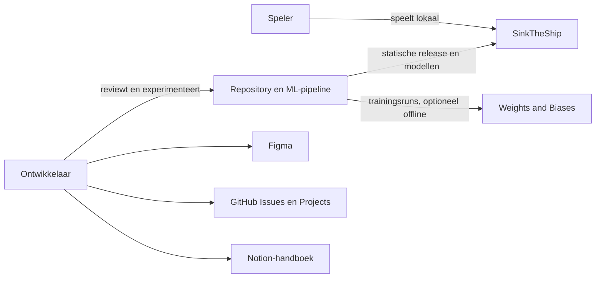
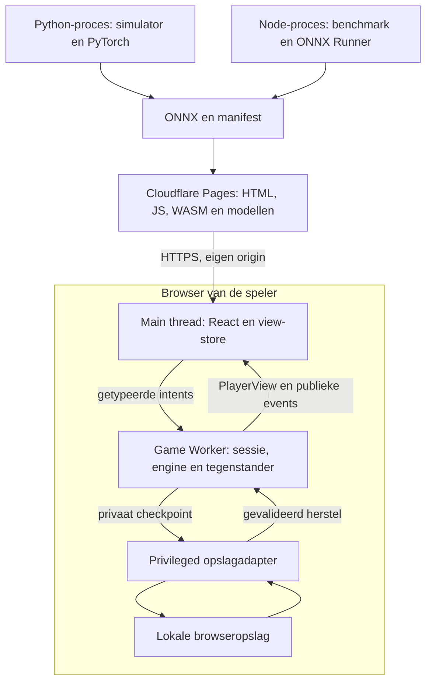
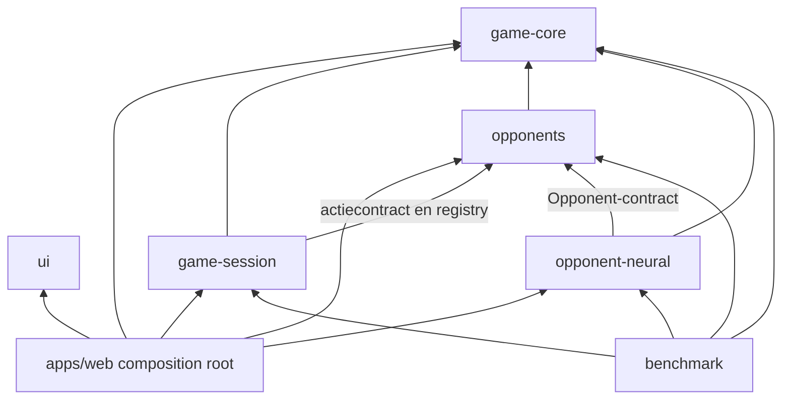

Status: Geaccepteerd

Versie: 1.2

Laatst gewijzigd: 2026-11-01

Gerelateerd: [Scope](01-product-vision-scope.md), [regels](02-game-rules.md), [engine](05-game-engine.md), [tegenstanders](06-opponents.md), [neural network](07-neural-network.md), [leeswijzer](README.md)

# Architectuur

De architectuur is gericht op kleine, afzonderlijk te reviewen bouwstenen. De engine kent alleen speldata en pure domeinfuncties. De sessielaag coördineert acties en adapters; React rendert uitsluitend toegestane views. Dit document specificeert grenzen en ports, geen implementatie.

## C4: context



De spelapp verstuurt geen speldata naar deze ontwikkeltools. Gebruikersaccounts worden in v1 en de eerstvolgende releases niet gebouwd of gebruikt. Dit is een bewuste keuze voor nu; accounts kunnen in een latere release worden toegevoegd.

## C4: containers en uitvoeromgevingen



Een Worker is een uitvoeromgeving binnen de browser, geen backend. Eén Game Worker voert lokale sessiecoördinatie, bots, zware validatie en later de ONNX Web-runner uit; zo blijft ook Hard buiten de main thread. Runtime en model worden pas bij Impossible geïmporteerd. Een tweede Worker wordt alleen toegevoegd als metingen dat rechtvaardigen. De benchmark gebruikt dezelfde engine en bots rechtstreeks in Node, zonder browsertransport of denkpauzes.

`apps/web` bevat één composition root met een main-entry en een worker-entry. Die twee entries zijn onderdelen van dezelfde compositie; packages creëren geen globale sessies. De Node-CLI heeft noodzakelijkerwijs een eigen proces-entry die dezelfde publieke factories assembleert. Dat is een uitvoeradapter, geen tweede implementatie van regels of algoritmen.

## C4: componenten en afhankelijkheden



Pijlen betekenen imports, niet gegevensstromen. De UI-package heeft React als peerdependency maar geen dependency op core, sessie of bots; containers in `apps/web` vertalen `PlayerView` naar presentational props. De core heeft nul runtime-dependencies. Ontwikkeltools zoals compiler en test-runner zijn geen runtime-dependencies.

## Modulecatalogus

Alle publieke TypeScript-API's worden via de package-root `index.ts` geëxporteerd. Configuratiepackages hebben een kleine `index.ts` voor metadata en expliciete configexports; hun test controleert dat afnemers de configuratie kunnen laden. Iedere package krijgt een README met doel, API, voorbeeld en uitbreiden, en eigen relevante tests.

| Bouwsteen | Verantwoordelijkheid en publieke API | Toegestane interne dependencies | Uitbreiding en eigen tests |
|---|---|---|---|
| `packages/game-core` | Regels/presets, geometrie, signatures, state machine, projectie, `Rng` en `TurnPolicy`; exports uit 02/05 | Geen | Nieuwe policy/preset; invarianten, geometry, serialisatie, RNG- en viewfixtures |
| `packages/opponents` | `Opponent`, registry, uniforme sampler, Easy/Normal/Hard, `Cancellation`, `Clock`, `WorkScheduler`, contract-testsuite en denkpauzedecorator | `game-core` | Nieuwe strategiemodule plus catalogusregistratie; gedeeld contract en eigen algoritmetests |
| `packages/game-session` | `SessionPort`, lokale coördinator, checkpoints, annulering en ports voor opslag/identiteit; gebruikt de tijd-/annuleringsports van opponents | `game-core`, `opponents` | Andere adapters via injectie; races, idempotentie, opslagfouten en hervatten |
| `packages/opponent-neural` | Neural `Opponent`, manifestcompatibiliteit, encoder en `ModelRunner`-port; geen browserglobals in domeinbestanden | `game-core`, `opponents` | Modelmap of runneradapter; encoding, compatibiliteit, fouten en pariteit |
| `packages/ui` | Tokens en presentational React-componenten met gecontroleerde props/callbacks | Geen andere workspace-runtimepackages | Componentvariant; component-, toetsenbord- en visuele tests |
| `packages/benchmark` | Node-CLI, arena, solo-evaluatie, metrics en rapporten | Core, sessie, opponents, neural | Nieuwe rapportage via dezelfde meetdata; referentieverdelingen, pairing en rapportreproduceerbaarheid |
| `packages/tsconfig` | Gedeelde compilerprofielen voor pure TS, Node en browser | Geen | Profiel met kleine compile-proef |
| `packages/eslint-config` | Gedeelde lintregels, inclusief toegestane imports/globals | Geen productpackages | Regel met positieve en negatieve configfixture |
| `apps/web` | Routes, containers, registraties, view-store, main/worker-compositie en browseradapters | Alle bovenstaande behalve benchmark | Route plus registratie; e2e, transport- en browseradaptertests |
| `apps/server` | In v1 uitsluitend README over toekomstige serverautoriteit | Geen v1-code | Later apart ontwerp en adapter; nu geen serverruntime of servertaak |
| `ml` | Python-simulator, dataset, training, evaluatie en export | Geen TS-imports; leest gedeelde fixtures en Node-rolloutbestanden | Trainingsconfig; pytest en TS/Python-pariteit |
| `models` | Per versie `model.onnx`, `manifest.json`, `MODEL_CARD.md` | Data, geen code | Nieuwe modelmap; manifest-/integriteits-/promotiecontrole |
| `fixtures` | Gedeelde JSON-gevallen met schema-/encodingversies | Data, geen code | Golden vector; beide talen moeten dezelfde verwachting halen |

Browseradapters staan aanvankelijk onder `apps/web/src/adapters`; de ONNX Web-runner is een worker-only adapter. De ONNX Node-runner staat bij de benchmark. Geen extra adapterpackage zonder daadwerkelijk hergebruik en een ADR. Het dependencydiagram bevat productie-imports; testhelpers mogen alleen in testconfiguraties extra dependencies hebben.

## Automatisch bewaakte grenzen

| Regel | Afdwinging |
|---|---|
| Alleen gedeclareerde lokale packages | `workspace:*` in dependencyvelden, expliciete package exports; geen relatieve paden naar een andere package |
| Geen deep imports | Alleen rootexport voor product-API; geen `src/`/`dist/`-imports van een afnemer, ook niet via een alias |
| Geen cycli of omgekeerde afhankelijkheden | dependency-cruiser met bovenstaande allowlist en controle van type-only imports |
| Pure core | Eigen TS-profiel zonder DOM-/Node-types; lint verbiedt `Math.random`, datum/timers, netwerk, opslag en React-imports |
| Geen geprivilegieerde state bij bots/UI | Importrestricties op `GameState`, interne records, checkpointtypes en de geprivilegieerde bridge; bots importeren alleen toegestane publieke coretypen en pure geometrie |
| Geen onbedoelde browsercode in Node of omgekeerd | Afzonderlijke entrypoints/adapters en compilerprofielen; de gemeenschappelijke packages hebben geen runtime-detectie met geheime alternatieve algoritmen |
| Consistente buildvolgorde | TypeScript project references met `composite` en declarations voor librarypackages; build met `tsc --build` |

Project references regelen de buildgraaf; zij vervangen de importregels niet. Bij dependency-cruiser staat `tsPreCompilationDeps` aan en worden ook typecycli verboden. Negatieve architectuurfixtures voegen bijvoorbeeld tijdelijk een React-import aan core of een deep import aan een bot toe; de check moet dan falen. Dit zijn geplande controles, geen al bestaande CI.

Bronnen via Context7, geraadpleegd op 2026-10-31: [pnpm workspaces](https://github.com/pnpm/pnpm.io/blob/main/docs/workspaces.md), [TypeScript project references](https://www.typescriptlang.org/docs/handbook/project-references.html), [dependency-cruiser opties](https://github.com/sverweij/dependency-cruiser/blob/main/doc/options-reference.md) en [regels](https://github.com/sverweij/dependency-cruiser/blob/main/doc/rules-reference.md). Zie [ADR 0043](adr/0043-dependency-enforcement.md).

## Contractcatalogus

| Contract | Eigenaar van de norm |
|---|---|
| `RuleSet`, `ShipSpec`, `Coord`, `Placement`, validatieresultaten en signatures | [02-game-rules](02-game-rules.md#formeel-datacontract) |
| `GameState`, `GameCommand`, `GameEvent`, `ShotOutcome`, `PlayerView`, `TurnPolicy`, `Rng` | [05-game-engine](05-game-engine.md) |
| `Opponent`, `OpponentRegistry`, `Cancellation`, `Clock`, `WorkScheduler` en inzichtdata | [06-opponents](06-opponents.md#tegenstandercontract); package `opponents` |
| `SessionPort`, `StorageAdapter`, `IdentityProvider` | Hieronder; package `game-session`, concrete checkpointsemantiek in 05 |
| `ModelManifest`, `ModelRunner`, `TensorSpec`, encoding en runtimeprofielen | [07-neural-network](07-neural-network.md#modelmanifest-en-runnercontract); package `opponent-neural` |

De namen uit andere documenten in onderstaande signatures verwijzen naar die contracten. Er worden geen afwijkende kopieën van coretypen gemaakt. De minimale tijd-/annuleringsports wonen bij `opponents`, omdat de denkpauzedecorator daar hun eerste afnemer is; `game-session` mag die package al importeren. Zo ontstaat geen omgekeerde import of nieuwe gedeelde-infrastructuurpackage.

```ts
type Unsubscribe = () => void;

interface StorageAdapter {
  read(key: string): Promise<string | null>;
  write(key: string, value: string): Promise<void>;
  remove(key: string): Promise<void>;
}

interface GuestIdentity {
  readonly id: string;
  readonly persistence: "persistent" | "session-only";
}

interface IdentityProvider {
  getIdentity(): Promise<GuestIdentity>;
}

interface PostgameDecision {
  readonly shotIndex: number;
  readonly observation: PlayerView;
  readonly insight: DecisionInsight;
}

interface PostgameReview {
  readonly decisions: readonly PostgameDecision[];
  readonly omittedDecisionCount: number;
}

interface OpponentSummary {
  readonly id: string;
  readonly version: string;
  readonly model: null | { readonly id: string; readonly version: string };
  readonly changedDuringGame: boolean;
}

interface SessionSnapshot {
  readonly rules: RuleSet;
  readonly opponent: OpponentSummary;
  readonly view: PlayerView;
  readonly postgame: PostgameReview | null;
  readonly events: readonly PublicGameEvent[];
  readonly activity: "idle" | "placing-opponent" | "thinking" | "loading-model";
  readonly persistence: "saved" | "saving" | "unavailable";
  readonly error: null | {
    readonly code: string;
    readonly retryable: boolean;
  };
}

type PlayerIntent =
  | { readonly type: "set-placement"; readonly placement: PlacementDraft }
  | { readonly type: "randomize-placement" }
  | { readonly type: "confirm-placement" }
  | { readonly type: "fire"; readonly coord: Coord };

type DispatchResult =
  | { readonly status: "accepted" | "duplicate" }
  | { readonly status: "rejected"; readonly code: string };

interface SessionPort {
  getSnapshot(): SessionSnapshot;
  subscribe(listener: () => void): Unsubscribe;
  dispatch(intent: PlayerIntent, requestId: string): Promise<DispatchResult>;
  retryPending(): Promise<void>;
  replaceOpponent(opponentId: string): Promise<void>;
  dispose(): Promise<void>;
}
```

`PlayerIntent.set-placement` gebruikt `PlacementDraft` uit 05 en mag in de editor onvolledig zijn; complete plaatsbaarheid is pas vereist bij confirm. De sessie bindt de lokale actor bij constructie: de UI mag geen andere `PlayerId` meegeven. `replaceOpponent` is een expliciete fout-/herstelkeuze, geen stille fallback; de sessie bewaart de wijziging in haar matchmetadata en labelt het resultaat als gemengd niveau. Een benchmark staat dergelijke vervanging niet toe. Een nieuw spel/rematch wordt door de composition root via een nieuwe sessie gemaakt; `dispose` annuleert de oude requests.

`getSnapshot()` geeft dezelfde objectreferentie terug zolang de zichtbare inhoud niet verandert. `rules` zijn de actuele gevalideerde publieke sessieregels, immutable en overeenkomend met `view.rulesSignature`; een setupdraft kan die niet vervangen. De snapshot bevat geen volledige engine-state of opslagpayload. `StorageAdapter.write` vervangt één key atomair of faalt; serialisatie, versies en migraties van checkpoints liggen bij de sessielaag. De overige browserrecords vallen onder de betreffende app-/adapterservice uit 08. De browser-storagebridge mag volledige checkpoints verwerken maar is niet exporteerbaar naar schermen, UI-components of bots.

Batch D preciseert de publieke frontendgrens: `opponent` benoemt de actuele controller en eventuele modelversie, zonder seeds, caches of runtimehandles. `changedDuringGame` wordt true bij een expliciete controllervervanging in dezelfde sessie en blijft dat na hervatten; de UI labelt het resultaat dan als gemengd niveau. `postgame` is altijd null tijdens placing/playing en ook null als geen inzicht beschikbaar is. Pas na finished mag de sessie de bewaarde computerbeslissingen publiceren. `PostgameDecision.observation` is een reconstructie van de botview onmiddellijk vóór het bijbehorende schot, met historische legalShots, turn en toegestane uitkomsten; nooit een eindview die als vroegere observatie wordt voorgesteld. Dit vraagt geen nieuwe modelinferentie en verbruikt geen RNG. `DecisionInsight` komt uit 06; de UI leidt het masker af uit de historische legalShots. De historische eigen botvloot is uitsluitend na afloop zichtbaar, wanneer de eindview die sowieso onthult. `omittedDecisionCount` telt eerder bewaarde maar vanwege de grens uit [08](08-frontend.md#opslag-migraties-en-meerdere-tabs) verwijderde beslissingen. Niet-geproduceerd inzicht wordt niet als gewist geteld. Alle gepubliceerde gegevens zijn immutable kopieën. Dit voegt geen dependency aan game-core of packages/ui toe.

`randomize-placement` laat de sessie de gedeelde sampler aanroepen met de private plaatsingsstroom van de mens; daarna commit zij een gewone `set-placement`-corecommand plus RNG. Reset gebruikt een lege `PlacementDraft`. `events` bevat de laatste publieke eventbatch uit 05. Abonnees dedupliceren op event-ID en initialiseren bij inschrijven hun cursor met de al aanwezige IDs; bij herstel start de batch leeg, zodat oude geluiden en live-regionmeldingen niet opnieuw afspelen.

### Modelgrens

De voorlopige modeltypen uit batch B zijn vervangen door het complete [manifest-/runnercontract in 07](07-neural-network.md#modelmanifest-en-runnercontract). `opponent-neural` bezit die contracten en de encoder. Browser-/Node-adapters implementeren `ModelRunner`; de sessie gebruikt publieke laadstatus en bewaart de exacte model-/profielreferentie. Alle typed arrays blijven buiten de JSON-checkpoints.

De Python-dataset-CLI kan de Node-rolloutproducer aanroepen via geversioneerde JSONL-bestanden. Klassieke strategieën blijven daardoor in `opponents`; Python replayt/valideert onafhankelijk en encodeert voor training. Dit is een proces-/datagrens, geen TS-import vanuit Python. Het model-/locale-buildcatalogusontwerp staat in [ADR 0036](adr/0036-model-and-locale-discovery.md).

## Verborgen informatie en veilige compositie

De sessie bewaart de volledige state in haar private closure. UI en tegenstander krijgen afzonderlijk door `projectPlayerView(state, player)` gemaakte data, zonder gedeelde mutable references. Alleen de geprivilegieerde kern kan een state transitie doen. Op het eind mag de projectie beide vloten vrijgeven; eerder blijven ze gescheiden.

Dezelfde projector verwerkt uitkomsten voor een schutter en een verdediger: de schutter ziet de gekozen onthullingen; de verdediger kent zijn eigen vloot al. Interne `GameEvent`-payloads gaan nooit direct naar de main-thread-viewbridge. Inzichtscores bevatten uitsluitend berekeningen uit de view van vóór een schot. Exceptions/logs bevatten geen volledige state. De opslagbridge gebruikt een apart berichttype en een eigen handler die niets in de React-store plaatst.

Deze grenzen voorkomen dat gewone productcode per ongeluk vals speelt. TypeScript, Workers en lokale opslag zijn geen beveiliging tegen de eigenaar die zijn eigen browser inspecteert of wijzigt. Latere multiplayer vervangt de lokale autoriteit door serverautoriteit; het clientcontract blijft view-gebaseerd.

## Registratie en uitbreidingsimpact

| Uitbreiding | Concrete wijziging |
|---|---|
| Tegenstander binnen bestaande ports | Eén module onder `opponents` met algoritme, descriptor en vertaalde metadata; één registratie in de builtin-catalogus plus tests. Web en benchmark gebruiken diezelfde catalogus. |
| Preset | Eén config-object en vertaalkeys; composition root ontdekt de presetconfiguraties en bouwt de registry. Geen branches op preset-ID in core of bots. |
| Model | Nieuwe modelmap met ONNX, manifest en modelkaart; buildcatalogus opnieuw genereren. Geen handmatige wijziging in een level-picker of model-switch. |
| Taal | Eén volledig vertaalbestand; buildvalidatie controleert ook de keys die module-descriptors leveren. |
| Scherm | Eén route-module plus registratie in de routecatalogus. |
| Online sessie | Later een remote `SessionPort`-/`Opponent`-adapter en transport in de composition root; geen WebSocket-imports in core of presentational UI. |

De builtin-catalogus bevat alleen Easy/Normal/Hard en latere strategieën uit dezelfde package. Neural levert zijn descriptor via `opponent-neural`; de web- en Node-composities injecteren ieder hun runner. Die initiële runtimebedrading is infrastructuur, geen extra registratie bij iedere nieuwe gewone moeilijkheid. Descriptorlabels worden als vertaalkeys geregistreerd, met Engelse/Nederlandse basisteksten in de nieuwe module; zo vraagt een nieuwe bot geen wijzigingen aan UI-componenten.

Nieuwe dependencies of een nieuwe runtimeport kunnen meer impact hebben en vereisen een eigen ADR; de extensieproef voor NFR-01 gebruikt de bestaande ports. De praktische gids en eventuele generator volgen in batch E. Geen speculatieve server-/authcode in v1.

## Hosting en verificatie

Voorkeur: Cloudflare Pages voor de statische v1, volgens [ADR 0020](adr/0020-static-host.md). Browserroutes krijgen SPA-fallback; ontbrekende modellen mogen niet als HTML worden geaccepteerd. Custom headers laten CSP en eventueel later COOP/COEP toe. Geen Pages Functions of andere backendcode in v1. Domein-/accountkoppeling en deployment worden pas bij hun geautoriseerde taak gedaan.

Architectuuracceptatie: US-07, US-08, US-20, US-22, US-24 en US-28. Controleer verboden imports met negatieve fixtures, vergelijk projecties voor verschillende verborgen vloten en laat de hervat-racetests in 05 slagen. Deze controles zijn ontworpen, nog niet uitgevoerd tegen applicatiecode.
