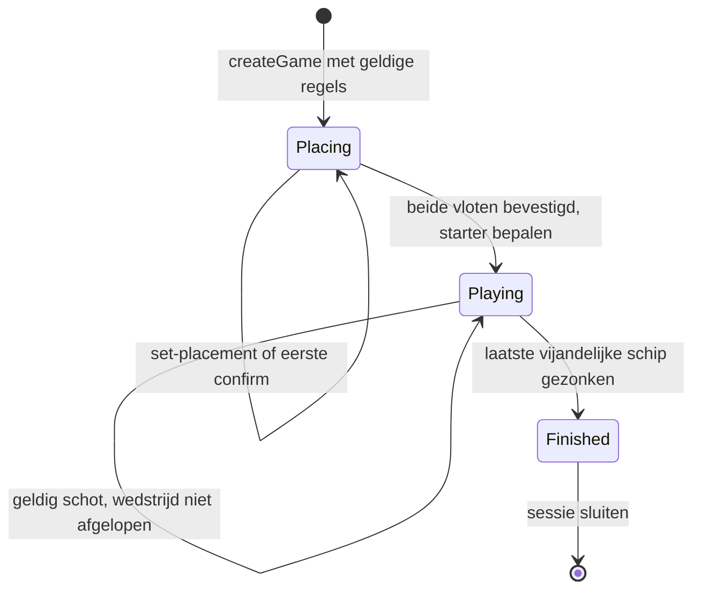

Status: Geaccepteerd

Versie: 1.0

Laatst gewijzigd: 2026-10-31

Gerelateerd: [Regels](02-game-rules.md), [architectuur](04-architecture.md), [tegenstanders](06-opponents.md), [stories](03-user-stories.md), [ADR 0028](adr/0028-state-events-and-replay.md)

# Game-engine en lokale sessie

De engine neemt data en een command aan en levert een nieuwe state plus interne events, of een afwijzing zonder wijziging. Regels en validatie volgen document 02. Rendering, timers, opslag, model-loading en asynchrone requests behoren niet tot de core.

## State machine



Rematch maakt een nieuw spel, geen overgang die de oude state leegmaakt. Laden, denken, een opslagfout en een modelprobleem zijn sessie-/UI-states; zij veranderen de fase van het spel niet. De pure engine krijgt geen `paused`-fase die door wall-clocktijd afhangt. In v1 bestaat geen turn-timeout of overgavecommand; toekomstige overgave wordt in document 11 ontworpen.

## Private state en publieke uitkomsten

De hier genoemde `RuleSet`, `RuleSignatures`, `PlayerId`, `Placement`, `ShipPlacement` en `Coord` zijn gedefinieerd in document 02. Een `PlacementDraft` is bewust geen gevalideerde complete `Placement`.

```ts
interface PlacementDraft {
  readonly ships: readonly ShipPlacement[];
}

interface RngState {
  readonly algorithm: "pcg32-xsh-rr-v1";
  readonly stateHex: string;
  readonly incrementHex: string;
}

interface Rng {
  nextUint32(): number;
  int(maxExclusive: number): number;
  exportState(): RngState;
}

interface RngFactory {
  fromState(state: RngState): Rng;
}

type ShotOutcome =
  | { readonly kind: "miss" }
  | { readonly kind: "hit"; readonly shipId?: string }
  | {
      readonly kind: "sunk";
      readonly shipId?: string;
      readonly cells?: readonly Coord[];
    };

interface PrivateShotRecord {
  readonly shotIndex: number;
  readonly shooter: PlayerId;
  readonly coord: Coord;
  readonly kind: "miss" | "hit" | "sunk";
  readonly shipId: string | null;
}

interface TurnState {
  readonly number: number;
  readonly activePlayer: PlayerId;
  readonly shotsRemaining: number;
}

interface GameBase {
  readonly schemaVersion: 1;
  readonly engineVersion: string;
  readonly gameId: string;
  readonly revision: number;
  readonly nextEventSequence: number;
  readonly rules: RuleSet;
  readonly signatures: RuleSignatures;
  readonly starterRng: RngState;
  readonly shots: readonly PrivateShotRecord[];
}

interface PlacingState extends GameBase {
  readonly phase: "placing";
  readonly drafts: Readonly<Record<PlayerId, PlacementDraft>>;
  readonly confirmed: Readonly<Record<PlayerId, boolean>>;
}

interface PlayingState extends GameBase {
  readonly phase: "playing";
  readonly starter: PlayerId;
  readonly placements: Readonly<Record<PlayerId, Placement>>;
  readonly turn: TurnState;
}

interface FinishedState extends GameBase {
  readonly phase: "finished";
  readonly starter: PlayerId;
  readonly placements: Readonly<Record<PlayerId, Placement>>;
  readonly turn: TurnState;
  readonly winner: PlayerId;
}

type GameState = PlacingState | PlayingState | FinishedState;
```

`PrivateShotRecord.shipId` is geprivilegieerd, ook wanneer het in de getypte structuur een gewone string is. `ShotOutcome` is juist de geprojecteerde uitkomst voor een specifieke viewer; optionele velden worden geheel weggelaten wanneer zij niet mogen worden onthuld. Geen `undefined` in opgeslagen JSON. `cells` is alleen aanwezig samen met `shipId` en een zinkuitkomst die positieonthulling toestaat, behalve voor de verdediger die zijn eigen vloot al kent.

Opstellen heeft geen schothistorie. Bij spelen zijn beide vloten compleet en onveranderlijk. `starter` wordt bij de tweede confirm eenmaal vastgelegd en bij hervatten niet opnieuw geloot. Beurt 1 hoort bij die starter; een extra schot binnen dezelfde beurt verhoogt het beurtnummer niet. Na winst blijft de laatste actieve speler de winnaar; quota is het restant na het winnende schot, zonder nieuwe bonus. Een `FinishedState` heeft geen toegestane acties.

## Commands en events

```ts
type GameAction =
  | { readonly type: "set-placement"; readonly placement: PlacementDraft }
  | { readonly type: "confirm-placement" }
  | { readonly type: "fire"; readonly coord: Coord };

interface GameCommand {
  readonly gameId: string;
  readonly commandId: string;
  readonly expectedRevision: number;
  readonly actor: PlayerId;
  readonly action: GameAction;
}

type EventPayload =
  | { readonly type: "placement-updated"; readonly player: PlayerId }
  | { readonly type: "fleet-confirmed"; readonly player: PlayerId }
  | { readonly type: "game-started"; readonly starter: PlayerId }
  | { readonly type: "shot-resolved"; readonly record: PrivateShotRecord }
  | { readonly type: "turn-started"; readonly turn: TurnState }
  | { readonly type: "game-finished"; readonly winner: PlayerId };

interface GameEvent {
  readonly sequence: number;
  readonly revision: number;
  readonly commandId: string;
  readonly payload: EventPayload;
}

type CommandError =
  | "WRONG_GAME"
  | "STALE_REVISION"
  | "INVALID_COMMAND"
  | "WRONG_PHASE"
  | "FLEET_LOCKED"
  | "INVALID_PLACEMENT"
  | "INCOMPLETE_FLEET"
  | "NOT_YOUR_TURN"
  | "OUT_OF_BOUNDS"
  | "ALREADY_SHOT";

type EngineResult =
  | {
      readonly status: "accepted";
      readonly state: GameState;
      readonly events: readonly GameEvent[];
    }
  | { readonly status: "rejected"; readonly error: CommandError };

interface TurnContext {
  readonly rules: RuleSet;
  readonly activePlayer: PlayerId;
  readonly shotsRemaining: number;
  readonly ownShipsAfloat: number;
}

interface TurnPolicy {
  readonly id: string;
  readonly version: number;
  beginTurn(context: TurnContext): number;
  afterShot(
    context: TurnContext,
    outcome: "miss" | "hit" | "sunk",
  ): { readonly switchPlayer: boolean; readonly shotsRemaining: number };
}

interface TurnPolicyRegistry {
  get(id: string, version: number): TurnPolicy | undefined;
}

declare function applyCommand(
  state: GameState,
  command: GameCommand,
  dependencies: {
    readonly rngFactory: RngFactory;
    readonly turnPolicies: TurnPolicyRegistry;
  },
): EngineResult;
```

`createGame` neemt een geldig validatieresultaat, game-ID, engineversie en starter-RNG-state aan en maakt revision 0 met lege drafts. De dependencyfactory maakt uitsluitend een nieuwe lokale RNG uit de aangeleverde state. Die clone mag muteren; inputstate en externe RNG-instances veranderen niet. Zo blijft `applyCommand` deterministisch en zonder externe bijwerkingen. Beurtpolicies zijn eveneens pure functies; `fixed@1` is de enige geregistreerde v1-policy.

| Command | Voorwaarden en effect | Interne events in volgorde |
|---|---|---|
| `set-placement` | Fase placing, eigen vloot niet bevestigd, geldige gedeeltelijke geometrie/IDs; vervangt de gehele draft | `placement-updated` |
| `confirm-placement` | Eigen draft compleet en geldig, nog niet bevestigd; vergrendelt de vloot | `fleet-confirmed`; bij tweede bevestiging vervolgens `game-started`, `turn-started` |
| `fire` | Playing, actieve speler, geldig nog niet door die speler beschoten vak; één record toevoegen | `shot-resolved`; bij winst `game-finished`, anders eventueel `turn-started` |

Iedere geaccepteerde command verhoogt `revision` precies één keer, ongeacht het aantal events. Eventsequences beginnen bij 1 en zijn aaneengesloten; alle events van dezelfde transitie dragen dezelfde nieuwe revision. Het eigenlijke eindevent komt vóór iedere mogelijke beurtwissel; bij winst is er geen `turn-started`. Events hebben geen timestamp of willekeurig gegenereerde ID.

Validatievolgorde: envelope/velden → game-ID → expected revision → actor/fase → actievoorwaarden → transitie. Een afwijzing consumeert geen randomness, schrijft niets en levert geen domain event. De sessie kan een lokale foutmelding tonen, maar telt die niet als schot. Idempotentie van `commandId` wordt vóór de core door de sessie afgehandeld; de core beschermt aanvullend met revision en dubbele-schotvalidatie.

## PlayerView en projectie

```ts
interface ProjectedShot {
  readonly shotIndex: number;
  readonly shooter: PlayerId;
  readonly coord: Coord;
  readonly outcome: ShotOutcome;
}

interface PlayerView {
  readonly gameId: string;
  readonly viewer: PlayerId;
  readonly phase: "placing" | "playing" | "finished";
  readonly starter: PlayerId | null;
  readonly rulesSignature: string;
  readonly ownFleet: PlacementDraft;
  readonly ownFleetConfirmed: boolean;
  readonly opponentReady: boolean;
  readonly shots: readonly ProjectedShot[];
  readonly legalShots: readonly Coord[];
  readonly turn: TurnState | null;
  readonly winner: PlayerId | null;
  readonly revealedOpponentFleet: Placement | null;
}

declare function projectPlayerView(state: GameState, viewer: PlayerId): PlayerView;

interface PublicGameEvent {
  readonly id: string;
  readonly payload:
    | { readonly type: "fleet-confirmed"; readonly player: PlayerId }
    | { readonly type: "game-started"; readonly starter: PlayerId }
    | { readonly type: "shot-resolved"; readonly shot: ProjectedShot }
    | { readonly type: "turn-started"; readonly turn: TurnState }
    | { readonly type: "game-finished"; readonly winner: PlayerId };
}

declare function projectGameEvents(
  events: readonly GameEvent[],
  stateAfter: GameState,
  viewer: PlayerId,
): readonly PublicGameEvent[];
```

`PlayerView.starter` is null tijdens opstellen en daarna de opgeslagen starter. De view encodeert fog of war met de publieke schothistorie: een vijandelijke cel zonder eigen schot blijft onbekend. De UI mag hiervan een celgrid afleiden. `ownFleet` bevat alleen eigen schepen; `revealedOpponentFleet` is uitsluitend na einde gevuld. `legalShots` is bij de actieve viewer een rij-major lijst van alle nog niet door hem beschoten cellen en anders leeg. Dit masker gebruikt geen verborgen water of schepen; logisch afgeleid water blijft een legaal, maar doorgaans onwenselijk schot.

Bij een eigen schot past de projector de onthullingsregels uit 02 toe. Bij een inkomend schot mag de viewer zijn eigen getroffen schip en gezonken positie kennen. Een tegenstander krijgt dus zijn eigen volledige bord maar nooit dat van de speler. Na afloop worden historische eigen uitkomsten niet herschreven: het apart vrijgegeven eindbord is geen trainingsinput voor eerdere beslissingen.

Er is geen geheime per-cel schip-ID in een ongeopende vijandelijke cel, geen private RNG-state en geen interne revision in `PlayerView`. De sessie gebruikt de revision alleen intern tegen verouderde async resultaten. Wijzigingen aan een nog verborgen vijandelijke draft leveren geen andere view op, zolang het publieke ready-signaal gelijk blijft.

Zinkkennis wordt conservatief opgebouwd uit deze data. Het huidige zinkschot hoort zeker bij een gezonken schip; eerdere treffers met hetzelfde publiek bekende schip-ID eveneens. Expliciet onthulde `cells` mogen worden gebruikt. Zonder zo'n bewijs blijft een eerdere treffer niet-toegewezen; een aangesloten cluster wordt nooit als één bewezen schip behandeld. Extra logische gevolgtrekkingen moeten uit dezelfde publieke data te bewijzen zijn en krijgen aparte fixtures.

De eventprojector gebruikt dezelfde onthullingsfunctie als de view. `placement-updated` wordt niet doorgegeven; de eigen editor ontvangt zijn nieuwe draft via de view. Publieke IDs worden opgebouwd uit game-ID, eventtype en het publieke spelersslot, schotindex of beurtnummer waar nodig. Zij bevatten geen interne revision, command-ID of sequence die verborgen draftbewerkingen telt. `game-started` en `game-finished` komen eenmaal per game voor. Geen volledige interne payload doorgeven en daarna alleen op clientniveau verbergen.

## Plaatsbaarheidsvalidatie

De vier vrijgegeven configuraties gebruiken de gevalideerde witness uit 02. Voor andere configuraties onderzoekt de validator schepen op aflopende lengte en daarna ASCII-ID. Kandidaten staan horizontaal vóór verticaal, per oriëntatie rij-major; lengte 1 heeft alleen horizontaal. DFS verwerpt overlap/contact direct. Een zoekknoop is iedere onderzochte kandidaatplaatsing, ook een direct verworpen kandidaat. De eerste complete oplossing bewijst validiteit; volledige uitputting bewijst onplaatsbaarheid.

De v1-compositie stelt voor algemene invoer `maxSearchNodes = 1_000_000` in. Wanneer de volgende kandidaat de limiet zou overschrijden volgt `inconclusive`; geen tijdafhankelijke stopuitkomst. De Worker voert de zoekopdracht uit. Deze validator zoekt één bewijs en gebruikt geen randomness; hij is een andere operatie dan de uniforme vlootsampler uit 06. De limiet is een projectkeuze, geen gemeten prestatienorm.

## Invarianten

| ID | Invariant |
|---|---|
| ENG-01 | Inputstate en command blijven onveranderd; output is JSON-data zonder functies, DOM-objecten, Map/Set, Date, BigInt of typed arrays. |
| ENG-02 | Rules/signatures/game-ID blijven binnen één wedstrijd constant; iedere opgeslagen signature wordt herberekend en vergeleken. |
| ENG-03 | Playing/finished heeft exact één geldige complete vloot per speler; overlap/contact voldoet aan 02. |
| ENG-04 | Per shooter is iedere geschoten coördinaat uniek; `shotIndex` is globaal 1-based en aaneengesloten. |
| ENG-05 | Mis heeft geen schip-ID; hit/sunk verwijst intern naar het werkelijke eigen vlootexemplaar van de verdediger. Een schip zinkt precies één keer. |
| ENG-06 | Playing heeft precies één actieve speler met positieve quota; alleen die speler mag schieten. |
| ENG-07 | Finished heeft precies één winnaar, alle vijandelijke schepen gezonken en geen latere acties. |
| ENG-08 | Afwijzing laat state, eventsequences en RNG exact gelijk; acceptatie verhoogt revision één keer. |
| ENG-09 | Projectie hangt uitsluitend van eigen vloot en publieke feiten af; verborgen plaatsingsvarianten geven identieke views bij dezelfde observatie. |
| ENG-10 | Serialiseren, laden, valideren en verder spelen geeft dezelfde uitkomst als ononderbroken spelen met dezelfde versies en invoer. |

Properties gelden ook voor engineconfiguraties buiten de vier v1-UI-combinaties. Grote of dichtbezette geldige configuraties hebben geen v1-performancegarantie; zij mogen niet met een ongeldige of anders verdeelde vloot worden versneld.

## Randomness en seeds

Voorstel: `pcg32-xsh-rr-v1`, volgens de minimale PCG32-referentie, met lokale instances. Het snapshot bevat state en de oneven increment als elk exact 16 lowercase hextekens. Rekenen gebruikt unsigned 64-bit wraparound voor state en unsigned 32-bit voor output; TS kan intern BigInt gebruiken en Python expliciete masks. BigInt zelf wordt nooit opgeslagen. Seeding volgt de referentieroutine; ruwe seedwoorden zijn geen reeds geïnitialiseerde state.

`Rng.int(n)` accepteert een geheel getal 1–2^32. Gebruik `limit = floor(2^32 / n) * n`, verwerp draws ≥ limit en neem de rest modulo n; ook `n = 1` verbruikt één draw. Dit vermijdt modulo-bias. Dit project verwerpt bovenaan het bereik; de PCG-C-helper verwerpt onderaan. Beide methoden zijn uniform, maar hun seedtraces zijn niet uitwisselbaar: TS en Python volgen de hier vastgelegde projectvariant.

Voor tellers groter dan 2^32 gebruikt de sampler een interne helper: neem de bitlengte van `n - 1`, combineer voldoende 32-bitwoorden met het meest significante woord eerst, maskeer overtollige hoge bits en verwerp waarden ≥ n. Zo is de acceptatiekans minstens een half en blijft de uitkomst exact uniform. Kleinere grenzen gebruiken `Rng.int`.

Referentievector voor de ruwe generator: initialiseer volgens de PCG-seedingroutine met `initstate = 42` en `initseq = 54`. De eerste zes unsigned outputs, in hex, zijn `a15c02b7`, `7b47f409`, `ba1d3330`, `83d2f293`, `bfa4784b`, `cbed606e`. De seedkeuze staat in de [vastgelegde officiële demo](https://github.com/imneme/pcg-c-basic/blob/bc39cd76ac3d541e618606bcc6e1e5ba5e5e6aa3/pcg32-demo.c); de overgang/seeding in de [bijbehorende referentiecode](https://github.com/imneme/pcg-c-basic/blob/bc39cd76ac3d541e618606bcc6e1e5ba5e5e6aa3/pcg_basic.c). Deze vector controleert `nextUint32`, niet de bounded helper.

Bronnen: [PCG-referentie](https://www.pcg-random.org/download.html) en [seeding/bounded draws](https://www.pcg-random.org/using-pcg-c-basic.html). PCG is reproduceerbare pseudorandomness, geen beveiligingsgenerator. Neem bij een port de toepasselijke bronvermelding/licentie mee; de keuze is vastgelegd in [ADR 0027](adr/0027-rng-and-fleet-sampling.md).

| Stroom | Eigenaar | Mag naar bot of UI? |
|---|---|---|
| Starter | Core, alleen bij tweede confirm | Alleen de gekozen starter, niet de RNG |
| Plaatsing player-1/player-2 | Sessielaag, per speler apart | Een sampler krijgt alleen zijn lokale RNG; de opponent-schietfunctie krijgt deze nooit |
| Schotkeuze player-1/player-2 | Sessielaag, per strategie apart | Alleen de RNG van de aangeroepen schietstrategie |
| Benchmarkdata/CI-bootstrap | Benchmarkdriver | Niet naar de te evalueren strategieën |

De browser-compositie verkrijgt per private stroom afzonderlijke entropie van de platformadapter, niet uit een publieke game-ID of gedeelde basis-seed die de bot kan reconstrueren. De benchmark legt expliciete seedparen per stroom in een seedplan vast; geen language-eigen `hash()` voor afleiding. Debug-/replayartefacten zijn geprivilegieerd. RNG-toestanden worden samen met het geaccepteerde effect gecommit.

## Checkpoints en async transacties

Een checkpoint is één geversioneerd privaat JSON-document, bestaande uit:

| Veld | Inhoud |
|---|---|
| `checkpointVersion` | 1; los van engine- en RuleSet-schemaversie |
| `game` | Volledige gevalideerde `GameState` |
| `opponents` | Per speler controller-ID/versie en eventueel exact model-ID/versie/digest; wijzigingen tijdens herstel worden geregistreerd |
| `randomStreams` | Plaatsings- en schot-RNG-state per speler; starter staat in `game` |
| `receipts` | Laatste maximaal 256 geaccepteerde request-IDs, canonieke intentinhoud en geaccepteerde revision |
| `insights` | Optionele postgame-inzichtdata per schot, gekoppeld aan de observatie vóór dat schot |

Een in-flight Promise, Workerhandle, timer of half gecommit AI-resultaat wordt niet opgeslagen. Na refresh bepaalt de sessie uit fase/turn welke actie nodig is en rekent die opnieuw met de opgeslagen RNG. Modelbestanden worden niet in het checkpoint gedupliceerd.

De coördinator voert één mutatie tegelijk uit:

1. Lees een intent of plan een botactie; leg game-ID, sessiegeneratie en verwachte engine-revision vast.
2. Maak een onafhankelijke view en clone van uitsluitend de benodigde RNG-stroom. Bereken plaatsing/schot en optioneel inzicht op die kopieën.
3. Na de await: controleer annulering, generatie, game-ID, revision en actuele fase/actor. Een verouderd resultaat wordt weggegooid, inclusief zijn verbruikte RNG.
4. Valideer het resultaat en voer het corecommand uit. Bij afwijzing wordt niets gecommit en wordt een botcontractfout zichtbaar; kies geen willekeurige vervangende zet.
5. Commit state, RNG, receipt en inzicht samen in geheugen. Publiceer de nieuwe `PlayerView` met opslagstatus saving.
6. Schrijf één volledig checkpoint. Bij succes wordt status saved; bij fout unavailable met uitleg. Een opslagfout draait de geaccepteerde zet niet terug. Pas na afhandeling van die schrijfopdracht wordt de volgende mutatie gestart.

De opslagqueue is geordend: een oudere write kan niet na een nieuwere write dezelfde key overschrijven. Checkpoints gebruiken een key per game-ID; een apart active-game-verwijzingsrecord wordt bij een nieuw spel pas na het eerste checkpoint veranderd. Een crash ertussen behoudt het vorige hervatbare spel; een onafgemaakte nieuwe verwijzing wordt nooit als geldige snapshot behandeld.

Een herhaald request-ID met dezelfde intent levert `duplicate` zonder nieuwe events, geluiden, RNG-verbruik of schoten. Hetzelfde ID met andere inhoud wordt afgewezen. Na eviction uit de receiptcache beschermt expected revision tegen replay van een oud corecommand; UI-request-IDs bevatten een per-clientinstantie unieke prefix om hergebruik na refresh te voorkomen. De toekomstige netwerkadapter zal zijn eigen reconnection-/deduplicatievenster expliciet versioneren.

Bij dispose, rematch of wijziging van niveau annuleert de sessie requests en verhoogt zij de generatie. Een Worker die annulering niet tijdig verwerkt kan door de adapter worden beëindigd; de laatst gecommitte toestand blijft geldig. Denkpauzes werken op `Clock`, nooit op game-RNG of core-events.

## Laden, migratie en replay

Laden parseert onbekende data, controleert versies, migreert uitsluitend ondersteunde oude checkpointversies en valideert daarna regels, plaatsingen, historie, turn, winner, signatures en RNG-formaat. Onbekende engine-/RNG-/modelversies worden niet stilzwijgend vervangen. De UI biedt uitleg en een expliciete herstelkeuze. Een migratie wordt eerst volledig in geheugen gevalideerd; de oude snapshot wordt niet vóór succes overschreven.

Een replay gebruikt engineversie, initiële regels/seedstates en geaccepteerde commands in vaste volgorde. Afgewezen commands kunnen als diagnostiek worden opgeslagen maar leveren geen domeineffect. Voor debugging en benchmarks kan de sessie een commandlog exporteren; snapshots gebruiken state als primaire hervatbron en vereisen geen onbeperkt event-sourcinglog. De gespeelde schothistorie blijft volledig aanwezig voor stateless bots en observaties.

## Verificatiegevallen

| ID | Aanvulling op RULE-gevallen en stories | Verwachting |
|---|---|---|
| SES-01 | Botrekentaak is bezig; pagina herlaadt vóór commit | Dezelfde view/RNG geeft dezelfde zet; precies één geaccepteerd schot |
| SES-02 | Oude Worker antwoordt na rematch of dispose | Antwoord en RNG worden genegeerd; nieuwe game blijft gelijk |
| SES-03 | Dubbele UI- of Workerrequest | Eén transitie, één receipt, geen dubbele effecten |
| SES-04 | Opslag faalt na geaccepteerd schot | In-memory spel gaat verder; hervatten gebruikt laatste geslaagde checkpoint en melding blijft zichtbaar |
| SES-05 | Oudere write wordt kunstmatig vertraagd | Queue bewaart volgorde; geen terugschrijven van oudere state |
| SES-06 | Complete checkpoint wordt gemanipuleerd | Validatie faalt vóór publicatie; geen geheime data in foutmelding |
| SES-07 | Zelfde view met verschillende verborgen vijandelijke vloten | Zelfde botbeslissing/inzicht bij dezelfde schot-RNG |
| SES-08 | Sunk-type bekend maar trefferscluster ambigu | Alleen bewezen onthullingen in view; geen clusterbrede schip-ID |

Koppeling: US-01, US-02, US-06, US-07, US-08, US-09, US-17, US-28 en US-29; ENG-01 t/m ENG-10 worden property-/fixturechecks. Er is nog geen engine geïmplementeerd; de beschreven checks zijn acceptatievoorwaarden voor de bouw.
