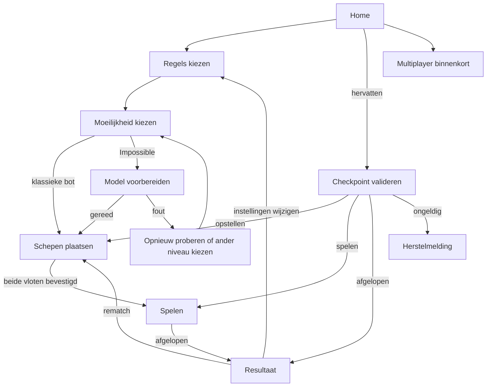

Status: Geaccepteerd

Versie: 1.0

Laatst gewijzigd: 2026-11-01

Gerelateerd: [Architectuur](04-architecture.md), [engine](05-game-engine.md), [tegenstanders](06-opponents.md), [ML](07-neural-network.md), [design brief](09-design-brief.md), [stories](03-user-stories.md), [leeswijzer](README.md)

# Frontend: navigatie, bediening en bewaren

React rendert toegestane views en stuurt intents naar de sessie. De private spelstate leeft in de Game Worker. `packages/ui` bevat presentatiecomponenten; `apps/web` bevat schermen, router, view-store, vertaling en browseradapters. Dit document specificeert gedrag en grenzen, geen implementatie.

## Routes en schermflow

Gebruik React Router in Declarative Mode met één routecatalogus, `BrowserRouter` en route-elementen. Lazy schermmodules gebruiken React-lazy/Suspense; de Data Mode-`lazy`-/loader-API wordt niet in een declaratieve router verondersteld. Zie [ADR 0037](adr/0037-react-router.md) en de [officiële modematrix](https://github.com/remix-run/react-router/blob/main/docs/start/modes.md), via Context7 gecontroleerd op 2026-10-31.

| Route-ID | URL | Scherm en gedrag bij rechtstreeks openen |
|---|---|---|
| `home` | `/` | HomeScreen; nieuw spel en, indien geldig, Hervatten; multiplayer met Binnenkort-label |
| `choose-rules` | `/play/rules` | RuleSelectionScreen; default Klassiek of bestaande setupkeuze |
| `choose-difficulty` | `/play/difficulty` | DifficultySelectionScreen; zonder geldige setup terug naar regelkeuze |
| `place-fleet` | `/play/place` | PlacementScreen; placing-checkpoint herstellen; zonder sessie via setup beginnen |
| `play-game` | `/play/game` | GameScreen; playing herstellen; placing → plaatsing; finished → resultaat; geen checkpoint → Home |
| `game-result` | `/play/result` | ResultScreen; alleen finished; anders de passende sessieroute of Home |
| `game-rules` | `/rules` | GameRulesScreen; regels van huidige sessie, anders setup, anders Klassiek |
| `ai-explained` | `/ai` | AiExplanationScreen; alle vier niveaus en beperkingen; inzicht alleen voor een afgerond spel |
| `settings` | `/settings` | SettingsScreen; taal en effectenvoorkeuren, met beschikbaarheidsuitleg |
| `multiplayer` | `/multiplayer` | MultiplayerFutureScreen; private match/quick play als toekomst, zonder verbinding |
| `private-room` | `/r/:roomKey` | RoomFutureScreen; gereserveerde ingang; geldige key als tekst tonen, geen join |
| `not-found` | `*` | NotFoundScreen; heldere 404 en link naar Home |

Routes bevatten geen game-state, seed, modelpad of gast-ID. De enige dynamische routewaarde is de toekomstige room key. V1 accepteert voor de weergave zes ASCII-alfanumerieke tekens, maakt lowercase hoofdletters en toont anders een nette ongeldige-linkmelding. Geen HTML-interpretatie of uitgebreidere protocolclaim: het uiteindelijke room-key-/verloopcontract volgt in 11. Ontbrekende of extra URL-segmenten vallen op 404. [ADR 0045](adr/0045-room-routes.md).



De modelstap is een state van de moeilijkheidspagina, geen extra URL. Rematch krijgt dezelfde regels/niveau maar een nieuw game-ID en nieuwe randomness; een benodigde modelhercontrole kan vóór plaatsing alsnog een herstelmelding geven. Geen stille downgrade. Directe routebezoeken wachten eerst op bootstrapvalidatie: een korte laadfase voorkomt foutieve redirects vóór de snapshot bekend is.

Een nieuw spel vervangt een lopend spel pas na een expliciete productdialog. De algemene router wist nooit een sessie. Terug/vooruit, spelregels, AI-uitleg en instellingen kunnen dus zonder discard-dialog worden geopend. Routeguards gebruiken vervangende navigatie voor ongeldige stappen, zodat Back niet blijft stuiteren. De statische host levert SPA-fallback; de app rendert zijn eigen 404.

`useBlocker` vereist een data-router en wordt hier niet ingezet. Een eventuele `beforeunload`-melding is alleen een laatste hulpmiddel bij nog niet bewaarde wijzigingen; autosave en herstel blijven de garantiegrens, niet een browserdialog. Een scheepspreview die nog niet is bevestigd is geen geaccepteerde game-actie.

## Store en lifecycle

| Toestand | Eigenaar | Bereikbaar voor schermen? |
|---|---|---|
| Volledige `GameState`, RNG en checkpoint | Worker/sessielaag plus geprivilegieerde opslagbridge | Nee |
| `SessionSnapshot` en publieke events | React-onafhankelijke view-store | Ja, immutable |
| Setupregels, gekozen niveau, model-loadprogress | Appcoördinator in `apps/web` | Ja; geen private vloot |
| Instellingen en lokale opslagstatus | Settings-service via adapter | Ja |
| Focuscoördinaat, geselecteerd schip, drag-/rotatiepreview, geopend dialog | React-presentatiestate | Ja; geen tweede engine |

De app abonneert zich via `useSyncExternalStore`. `getSnapshot` houdt dezelfde referentie zolang zichtbare inhoud niet verandert; subscribe levert cleanup en houdt een stabiele functiereferentie. [React-documentatie](https://react.dev/reference/react/useSyncExternalStore). De composition root bezit de Worker en de sessie buiten routecomponenten. Mount/unmount of StrictMode-effectcontrole mag geen nieuwe match, dubbele abonnementen of dubbele botactie veroorzaken. [ADR 0038](adr/0038-external-react-store.md).

Schermen vertalen de view naar gewone props en callbacks. Zij importeren geen private checkpointtypen. De definitieve spelregels en actuele tegenstander komen uit `SessionSnapshot.rules` en `.opponent`, niet uit een inmiddels gewijzigde setupdraft. Een vervangen tegenstander krijgt ook na refresh het label gemengd niveau. Postgame-inzicht komt uitsluitend uit het na afloop gevulde `SessionSnapshot.postgame` uit 04; de UI leest daarvoor geen storagepayload. Intenten krijgen een per-clientinstantie uniek request-ID; tijdens verwerking wordt dubbele activatie visueel geblokkeerd, terwijl sessie/core de echte idempotentie bewaken. Publieke event-IDs worden eenmaal verwerkt voor geluid/live-regions; bij inschrijven wordt de al aanwezige batch als gezien gemarkeerd.

Alle modelvoorbereiding blijft in app-/runneradapters. De view-store kan `ModelLoadProgress` tonen zonder een neural-import aan `game-session` toe te voegen. Model laden is pas gereed na validatie en initialisatie uit 07, niet na alleen het netwerkpercentage. Bij navigatie blijft een geldig voorbereid model beschikbaar; rematch/ander niveau annuleert oude requests volgens generatiecontrole.

Spelregels/instellingen openen verwijdert de sessie niet. Als een spel daar op de achtergrond eindigt, verschijnt een resultaatlink; de app navigeert niet onverwacht weg uit de uitleg. De volgende bezoeker van de spelroute krijgt de juiste fase. Een browser kan een achtergrondtab vertragen of beëindigen; hervatten blijft daarom gebaseerd op de laatst opgeslagen toestand, niet op een beloofde timerduur.

## Pointer- en toetsenbordbediening

| Actie | Muis/touch | Toetsenbord | Domain-effect |
|---|---|---|---|
| Schip selecteren | Klik/tik in vlootlijst of op eigen schip | Tab naar vlootlijst, Enter/Spatie | Alleen editorselectie |
| Plaatsingspreview | Selecteer en wijs een startcel aan; slepen vanaf schip is aanvullend | Pijltjes bewegen de startcel | Nog geen commit |
| Roteren | Zichtbare Roteren-knop | R wanneer de editor/bordfocus actief is | Preview wisselt rond dezelfde startcel |
| Plaatsen/verplaatsen | Klik/tik de cel of laat drag los | Enter/Spatie op startcel | Geldige nieuwe gehele draft naar sessie |
| Annuleren | Buiten bord loslaten of Annuleren | Escape | Oude geaccepteerde draft blijft staan |
| Willekeurig plaatsen | Zichtbare knop; bevestig vervangen van niet-lege draft | Gewone knopbediening | `randomize-placement`, gedeelde uniforme sampler |
| Reset | Zichtbare knop; bevestig bij niet-lege draft | Gewone knopbediening | Lege `PlacementDraft` |
| Vloot bevestigen | Start-knop bij complete geldige vloot | Gewone knopbediening | `confirm-placement`; daarna vergrendeld |
| Schieten | Eén klik/tik op legaal vijandelijk vak | Enter/Spatie op gefocuste cel | Eén `fire`-intent |

Slepen gebruikt Pointer Events, pointer capture en expliciete afhandeling van `pointercancel`/verloren capture. Beperk `touch-action: none` tot het draggebied dat dit nodig heeft; gewone paginascroll en zoom buiten dat gebied blijven mogelijk. Begin geen schot bij `pointerdown`: pas een afgeronde activatie zonder drag-/cancelconditie telt. Pointer-, keyboard- en clickroutes eindigen in dezelfde intenthandler, zodat een synthetische click niet een tweede actie veroorzaakt. De [Pointer Events-documentatie](https://developer.mozilla.org/en-US/docs/Web/API/Pointer_events), geraadpleegd via Context7 op 2026-11-01, beschrijft capture en annulering.

Plaatsingsvaliditeit wordt met dezelfde coregeometrie gecontroleerd, zowel voor preview als definitieve commit. Een ongeldige rotatie verschuift het schip niet om toch te passen. Preview en fouttekst noemen buiten-bord, overlap of contactregel. Bij een afwijzing blijft de vorige plaatsing zichtbaar; geen gedeeltelijke mutatie van het schip. Slepen is nooit de enige manier om te plaatsen.

## Gridsemantiek, focus en meldingen

Ieder bord is een afzonderlijk gelabeld ARIA-grid, met rows, row-/columnheaders en gridcells. Gebruik één roving tabstop per bord op de huidige gridcell; de overige cellen hebben `tabIndex=-1`. Beschoten of tijdelijk niet-activeerbare cellen blijven met pijltjes inspecteerbaar, met een passende `aria-disabled` en resultaatlabel. Een disabled-look is geen vervanging voor eventvalidatie. Het eigen bord is tijdens spelen read-only.

| Toets | Bordgedrag |
|---|---|
| Pijltjes | Eén cel horizontaal/verticaal; stoppen aan de rand, geen wrap |
| Home / End | Eerste/laatste cel van de huidige rij |
| Ctrl+Home / Ctrl+End | Eerste/laatste bordcel |
| Enter / Spatie | Plaats of vuur volgens mode, fase en geldigheid; Spatie scrollt dan niet |
| Tab / Shift+Tab | Verlaat het grid naar de volgende/vorige bediening; geen 100 tabstops |
| R / Escape | Alleen in actieve plaatsing: roteren / preview annuleren |

Celnaam: bordnaam, coördinaat, publieke toestand en relevante actie, bijvoorbeeld “Vijandelijk bord, B4, onbekend, schieten”. Noem nooit verborgen schip-ID's. Mis gebruikt een punt, hit een kruis, sunk een ingevuld kruis/contour met tekst; focus gebruikt een aparte ring, niet een andere speltoestand. Een onbekende cel met een heatmap blijft qua toegestane actie onbekend.

Na een eigen schot blijft focus op die cel. Tijdens de computerbeurt wordt focus niet weggehaald; activatie is geblokkeerd met uitleg. Een beurtwissel kondigt beschikbaarheid aan zonder de gebruiker uit een dialog of tekst te trekken. Bij normale schermnavigatie krijgt de paginatitel focus (`tabIndex=-1`); bij rematch de plaatsingskop en daarna logische Tab-volgorde. Een wissel tussen eigen/vijandelijk bord bewaart per bord de laatste cel en activeert geen schot.

Eén vooraf aanwezige `aria-live="polite"`/statusregio bundelt een schotuitkomst en eventuele beurtwissel. Een nieuwe uitkomst heeft een korte tekst; een lange reeks extra schoten krijgt daarnaast een leesbaar ShotLog. Kritieke herstel-/modelproblemen staan in een blijvend bericht of modal met duidelijke actie; geen stroom van assertive alerts. Schermwissels spelen geen oude eventmeldingen opnieuw af.

Dialogs hebben naam/beschrijving, modal-semantiek, een logische beginfocus, focusbegrenzing, Escape waar annuleren kan, en focusherstel naar de trigger. Bij het wissen/vervangen van gegevens ligt de beginfocus op de veilige keuze. De [WAI-APG-gridrichtlijn](https://www.w3.org/WAI/ARIA/apg/patterns/grid/) en [dialogrichtlijn](https://www.w3.org/WAI/ARIA/apg/patterns/dialog-modal/) onderbouwen het patroon; dit vervangt geen handmatige screenreadertest. [ADR 0016](adr/0016-devices-and-accessibility.md).

## Responsive layout en effecten

Op 320/390 px staat één bord tegelijk in beeld, met zichtbaar gelabelde bordkeuze. Bij 768 px blijft één bord actief, eventueel met vloot/status ernaast. Vanaf 1024 px kunnen de twee borden naast elkaar; 1440 px is het desktopdesign. Houd een leesbare maximale contentbreedte en laat instellingen/knoppen wrappen. Geen essentiële actie alleen via hover.

Bij normale tekstgrootte past een 10 × 10-bord op 320 px: 16 px paginapadding per kant laat 288 px over; 24 px voor rijlabels plus tien cellen van minimaal 24 px vraagt 264 px. Borders zitten in de celmaat, geen extra gaps. Overige primaire bediening is minimaal 44 × 44 CSS-pixels. Bij tekstzoom krijgt het tweedimensionale bord indien nodig een eigen scrollgebied met zichtbaar blijvende focus; de rest van de pagina blijft reflowen. De uitgewerkte tokens en schermmatrix staan in 09.

Voorkeur `animations` mag effecten uitschakelen; systeem-reduced-motion gaat altijd voor. Zonder beweging blijven hit/sunk/winst direct door tekst en iconen herkenbaar. Geluid start alleen na een gebruikersinteractie, kan worden gemutet en draagt geen exclusieve informatie. Als Should-effecten nog niet gebouwd zijn, blijven de opties zichtbaar maar niet bedienbaar met uitleg. Stijlkeuze en optionele dark-modefunctie zijn afzonderlijk: een donker basisontwerp verplicht geen themaschakelaar.

## i18n en locale-discovery

Gebruik i18next/react-i18next met eigen bestanden en expliciete taalkeuze. Engels is de eerste default; een geldige opgeslagen keuze gaat voor. Geen automatische detectie op browsertaal. De taal verandert zonder rematch, andere signatures of RNG-verbruik. [ADR 0039](adr/0039-react-i18next.md).

```ts
interface LocaleFile {
  readonly schemaVersion: 1;
  readonly locale: string;
  readonly nativeName: string;
  readonly messages: Readonly<Record<string, string>>;
}

interface SettingsRecord {
  readonly schemaVersion: 1;
  readonly locale: string;
  readonly sound: boolean;
  readonly animations: boolean;
}
```

Eén JSON-bestand per taal onder de toekomstige locale-map. Locale is een gevalideerde BCP-47-tag; geen union die bij een nieuwe taal moet worden aangepast. De build ontdekt bestanden volgens ADR 0036. Keys zijn vlakke strings met punten, bijvoorbeeld `game.turn.yours`; configureer daarvoor `keySeparator: false`. De catalogus voegt geregistreerde EN/NL-moduleteksten toe zonder dubbele conflicterende keys. Een nieuwe taal moet de complete resulterende keyset leveren, inclusief modulelabels.

Alle zichtbare tekst, errors, tooltips, `aria-labels`, live-regions, pluralen en documenttitels gebruiken keys. Geen zinnen bouwen door vertaalde brokjes samen te voegen. De build controleert ontbrekende/extra keys, de voor de taal vereiste pluralvormen en dezelfde interpolatievariabelen. Engelse fallback is alleen herstelgedrag, geen reden om een onvolledige Nederlandse release te accepteren.

`changeLanguage` wacht op het eigen locale-asset voordat de actieve taal wisselt; bij laadfout blijft de bestaande taal bruikbaar met uitleg. React rendert interpolaties als tekst; er zijn geen HTML-vertalingen of `dangerouslySetInnerHTML`-paden. De gebruikelijke `escapeValue: false` is alleen passend binnen die React-tekstgrens. [react-i18next-initialisatie](https://react.i18next.com/getting-started), via Context7 gecontroleerd op 2026-10-31. Zet ook documenttaal en lokale nummernotatie goed. EN mag in de startbundel zitten; andere talen laden van eigen origin.

## Opslag, migraties en meerdere tabs

V1 gebruikt een localStorage-implementatie van `StorageAdapter` voor kleine JSON-records. De Promise-port maakt de onderliggende synchrone operatie niet asynchroon; houd payloads beperkt en meet de bridge op de telefoon. De Worker serialiseert/valideert, de afgescheiden main-thread-handler schrijft; React krijgt geen privaat JSON. Binaire modellen gebruiken de cache uit 07, niet localStorage. [ADR 0029](adr/0029-local-persistence.md).

| Key / record | Inhoud en grens |
|---|---|
| `sinktheship:settings` | `SettingsRecord` versie 1; defaults locale en, sound false, animations true; maximaal 16 KiB UTF-8 |
| `sinktheship:identity` | Recordversie 1 met lokaal gegenereerde opaque gast-ID; maximaal 4 KiB |
| `sinktheship:setup` | Recordversie 1 met gevalideerde regels/presetkeuze en niveau-ID vóór matchcreatie; maximaal 32 KiB |
| `sinktheship:match:<id>` | Volledig checkpoint versie 1 uit 05; maximaal 512 KiB UTF-8 |
| `sinktheship:active-match` | Recordversie 1 met verwijzing naar het laatst gekozen spel; maximaal 4 KiB |

Setup bewaart geen vloot; zodra de sessie bestaat is de checkpoint leidend voor plaatsing, regels en niveau. Een rematch begint met een lege menselijke draft, zoals 03 vereist. Settings en identity zijn onafhankelijke records; geschiedenis wissen verwijdert niet het lopende spel. Niet-geleverde Could-functies krijgen nog geen verplichte records of opslagcode.

Checkpoint-insightdata wordt beperkt tot de laatste 20 bewaarde computerbeslissingen. Bewaar `DecisionInsight` met de bijbehorende globale shotIndex en het aantal vanwege deze limiet verwijderde beslissingen, geen volledige viewkopie per schot. De sessie reconstrueert de historische observatie/het legale masker vanuit de toen bekende gegevens en het historieprefix, en geeft die alleen na afloop als `PostgameReview` vrij. De UI vermeldt grens en eventuele omissies. Ontbrekende scores worden nooit alsnog uit het eindbord berekend. Nooit corestate afkappen om een limiet te halen: bij te grote/volle opslag blijft het spel in geheugen speelbaar met de bekende waarschuwing uit 05.

Laden: record aanwezig → JSON/schema controleren → ondersteunde migratieketen → inhoudelijke validatie → publiceren → pas daarna een nieuw record schrijven. Versie 1 heeft nog geen historische migratie, dus het productregister begint leeg. Een latere versie voegt expliciete geteste migraties toe; verzin geen legacy-v0 om de eerste release te vullen. Checkpointfouten, onbekende checkpointversies en ongeldige actieve verwijzingen openen herstel met Opnieuw proberen en Nieuw spel beginnen; vóór die expliciete keuze blijft het origineel bewaard. Nieuwe data wordt niet boven een te nieuwe snapshot geschreven.

Foute settings/setup blokkeren geen verder geldig spel: gebruik veilige in-memorydefaults met uitleg en vervang het onleesbare record pas na expliciet Voorkeuren herstellen of een nieuwe setup bevestigen. Een onleesbare identiteit gebruikt de tijdelijke gastfallback van `IdentityProvider`. Checkpointmigraties horen bij `game-session`; settings-/setup-/identitymigraties bij hun app-/adapterservice. Geen van deze herstelacties verwijdert impliciet de andere records.

localStorage kan wegens beleid of quota niet werken en geldt per origin. Zie [de platformdocumentatie](https://developer.mozilla.org/en-US/docs/Web/API/Window/localStorage). Bewaar failures als zichtbare appstatus; herprobeer alleen op verzoek of de volgende geaccepteerde wijziging. Meld exact dat refresh hoogstens de laatste succesvolle snapshot kan herstellen. Een niet-bestaande of verwijderde locale krijgt tijdelijk EN als actieve taal; het oorspronkelijke record wordt niet als corrupte game-state behandeld.

Voor het actieve spel is er maximaal één schrijvende tab. De browseradapter verkrijgt een exclusieve Web Lock `sinktheship:active-session:v1` en houdt die voor de sessielifecycle vast. Andere tabs tonen dat het spel elders openstaat en bieden Opnieuw proberen; zij starten geen tweede botcoördinator op dezelfde snapshot. Geen automatisch geforceerde overname op een timer. De [Web Locks API](https://developer.mozilla.org/en-US/docs/Web/API/Web_Locks_API) coördineert same-origin toegang; de core kent deze API niet.

Als de lockvoorziening ontbreekt kan een nieuw tijdelijk spel in geheugen draaien met expliciete uitleg, zonder een bestaand persistent spel te overschrijven; voorkeuren blijven dan eveneens tijdelijk. De releasematrix moet lockondersteuning in alle vereiste browsers controleren. Settingswrites gebruiken een korte afzonderlijke lock met read–validate–patch–write binnen die lock, zodat een oude tab niet andere gewijzigde velden terugdraait. De identiteit gebruikt bij eerste read/create ook een korte eigen lock. Setup- en matchwrites vallen onder de sessielock. Een storage-event vernieuwt de settings-view van andere tabs. Bij sluiten/crash laat de browser een lock los; de nieuwe eigenaar valideert eerst het laatst geslaagde checkpoint. Dit is gegevenscoördinatie, geen anti-cheat tegen de eigenaar.

## Fout- en laadstates

| State | Zichtbaar resultaat | Toegestane volgende actie |
|---|---|---|
| Bootstrap bezig | Korte status met naam van de taak; geen foutieve lege-gameweergave | Wachten; bij blijvende fout herstel |
| Rules invalid/unsupported/inconclusive | Uitleg per foutklasse, geen start | Terug naar geldige preset |
| Sampler bezig | Annuleerbare plaatsingsstatus | Annuleren; geen gedeeltelijke vloot accepteren |
| AI denkt | Beurtindicator, bord inspecteerbaar | Geen menselijke schotcommit; uitleg/instellingen blijven bereikbaar |
| Model laadt | Echte voortgang waar bekend, anders faselabel | Annuleren, herproberen of expliciet ander niveau |
| Model faalt tijdens spel | Geen nieuw schot; actuele sessie en regels blijven staan | `retryPending` of expliciet `replaceOpponent` met Hard; registreer de niveauswitch volgens 05 |
| Opslag onbeschikbaar | Blijvend compact bericht over beperkte hervatbaarheid | In-memory doorspelen of opnieuw bewaren |
| Andere tab bezit sessie | Uitleg en read-only/niet-gestarte sessie | Andere tab sluiten of opnieuw proberen |
| Routechunk ontbreekt na deployment | Herlaadactie met behoud van opgeslagen spel | Gecontroleerd opnieuw laden; geen automatische dataverwijdering |
| Onverwachte UI-fout | Error boundary met veilige herstelactie | Herladen/Home; foutdetail bevat geen private state |

## Performance en verificatie

De normen uit 01 blijven gelden: initiële JS ≤200 KiB gzip exclusief lazy neural-bestanden; Lighthouse Performance ≥90 en Accessibility 100 op het vast te leggen mobiele profiel; animatie-framewerk p95 ≤16,7 ms voor 60 fps. Rekenwerk en inference blijven in de Worker; JS/locale-/font-/modelkosten worden afzonderlijk gerapporteerd. Routechunking, stabiele views en kleine checkpointwrites ondersteunen deze doelen. Q-06 en document 12 leggen het meetprotocol vast; scores zijn nog niet gemeten.

| Geval | Koppeling en geplande verificatie |
|---|---|
| UI-01 | US-01/09/14: directe routes, Back/Forward, rematch, hostfallback en app-404 |
| UI-02 | US-04/05/06: drag, selecteer-klik, rotatie, cancel en keyboard leveren dezelfde geldige intents |
| UI-03 | US-07/17: DOM/props/events bevatten geen private vloot of model-inputlabels |
| UI-04 | US-08/28: refresh tijdens denken/plaatsing, corrupte/te nieuwe records, quota en twee tabs |
| UI-05 | US-11/20: taal toevoegen met één bestand, ontbrekende key/placeholder faalt build, wisselen behoudt game |
| UI-06 | US-12/21: reduced motion, mute, 320/390/768/1440, tekstzoom, keyboard en screenreader |
| UI-07 | US-13/22: cold/warm model-loading, annulering, chunkfout en bruikbare UI tijdens rekenen |
| UI-08 | US-23: URL-/storage-invoer als data, eigen-origin assets en geen dev-only seedbediening in productie |

Tests worden later geïmplementeerd met de tooling uit batch E. De flows in deze batch zijn productspecificaties, geen al werkende schermen.
