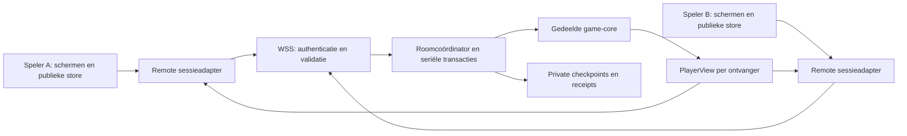
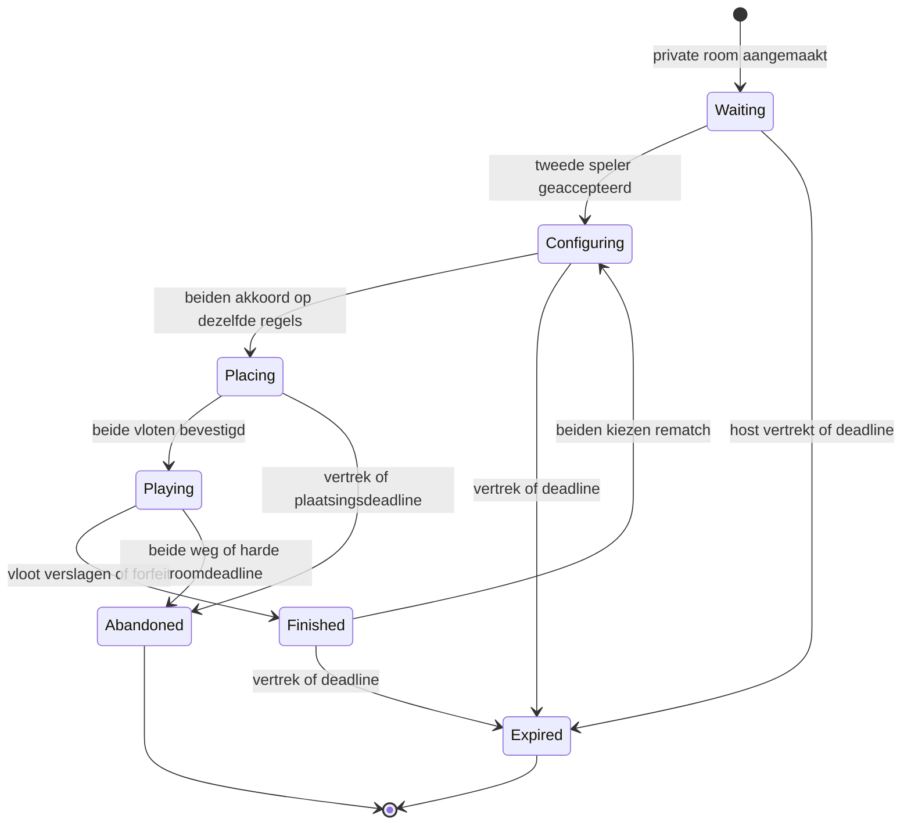

Status: Toekomst

Versie: 1.0

Laatst gewijzigd: 2026-11-01

Gerelateerd: [Scope](01-product-vision-scope.md), [architectuur](04-architecture.md), [engine](05-game-engine.md), [frontend](08-frontend.md), [ADR 0046](adr/0046-authoritative-session.md), [leeswijzer](README.md)

# Multiplayer na v1

Dit document beschrijft een later te bouwen release. V1 bevat uitsluitend de gereserveerde routes en de reeds bruikbare ports. Er wordt nu geen server, WebSocket-client, wachtrij of accountfunctionaliteit geïmplementeerd.

Gebruikersaccounts worden in v1 en de eerstvolgende releases niet gebouwd of gebruikt. Dit is een bewuste keuze voor nu; accounts kunnen in een latere release worden toegevoegd.

## Autoriteit en bestaande naden

De server draait dezelfde versie van `game-core`, valideert iedere actie en bewaart beide vloten, de gelote starter, RNG-states en requestreceipts. Een client vraagt acties aan en ontvangt uitsluitend zijn `PlayerView` en publieke events. Een client mag geen hit/sunk/winner, eigen actor-ID, RNG-state of volgende beurt vaststellen. Lokaal tekenen van een plaatsingspreview blijft mogelijk; de servercommit beslist of de plaatsing geldig is.



| Nuttig in v1 | Latere aansluiting | Wat blijft gelijk? |
|---|---|---|
| `PlayerView`, `PublicGameEvent`, projectie | Server maakt per ontvanger een kopie | Informatie- en renderinggrens |
| `SessionPort` met snapshot/subscribe/dispatch | Remote facade op de client | Scherminteractie via publieke data en intents |
| `Opponent` en injected cancellation | Serveradapter kan een gevalideerde menselijke actie uit een queue leveren | Engine-/botcontract blijft bruikbaar op de server |
| `IdentityProvider` | Opaque lokale gastidentiteit naast apart server-issued reconnectcredential | Geen naam/e-mail nodig |
| `StorageAdapter` | Servercheckpointadapter; client bewaart alleen toegestane view/resumegegevens | Engine heeft geen opslag-API |
| Seriële commits, receipts, generatie/revision | Servertransacties plus duurzame replaybescherming | Geen dubbele of verouderde zet |
| Rule/presetregistries en signatures | Hostkeuze en matchmaking op gevalideerde regels | Geen regelswitches in UI/core |
| `/multiplayer` en `/r/:roomKey` | Echte lobby/roomcontainers | Bestaande route-intentie en presentatiecomponenten |

**Een `Opponent`-adapter alleen is onvoldoende voor serverautoriteit.** Een browserbotadapter die `placeFleet` voor de andere speler retourneert zou juist diens vloot onthullen. Daarom lopen volledige sessiesynchronisatie en autoriteit via een remote sessieadapter. Een eventuele `RemotePlayerOpponent` leeft alleen op de server: hij ontvangt de eigen ingezonden vloot en queued acties, zonder verborgen toestand naar een andere client te sturen. Dit preciseert de uitbreidingsbelofte uit de masterprompt; zie ADR 0046.

De lokale `SessionSnapshot.opponent` en modelherstelmethoden uit 04 zijn bewust voor computerwedstrijden. Een toekomstige remote facade gebruikt een nieuw onderscheiden roomcontract, met speler/presence en zonder `replaceOpponent` naar Hard. Wijzig daarvoor compositie en featurecontainers; hergebruik de publieke `PlayerView` en `packages/ui`-props. Voeg vandaag geen lege netwerkvelden aan v1 toe. Er wordt dus geen onrealistische claim gedaan dat lobby, timers en twee mensen zonder enige nieuwe appcoördinatie kunnen werken.

## Rooms, sleutels en regels

Private match: host kiest een v1-preset of toegestane customconfig, krijgt een link `/r/K7QX2M`, en deelt die zelf. Zes tekens uit `ABCDEFGHJKMNPQRSTUVWXYZ23456789`, hoofdletterongevoelig; whitespace alleen aan de randen verwijderen. Dit sluit 0/O en 1/I/L uit. Genereer uniform met cryptografische randomness, controleer uniciteit bij reservering en probeer opnieuw bij een botsing. Er zijn 31^6 = 887.503.681 mogelijke sleutels. De sleutel is vindbaarheid voor een lobby, geen bezitbewijs voor een spelersslot.

De ruimere v1-presentatievalidatie uit 08 verandert tijdens de online release naar dit protocolformaat. Leg deze aanscherping en de foutmelding in routertests vast. Een verlopen/syntactisch ongeldige/onbeschikbare room geeft een generieke onbeschikbaarmelding zonder te bevestigen wie erin zit. Een room-ID is een andere opaque identifier en wordt niet hergebruikt voor een nieuwe room.

Voorgestelde termijnen: een wachtende private room verloopt 15 minuten na creatie, een configuratiefase na 10 minuten, plaatsing na 5 minuten vanaf de vastgezette regels, een afgelopen room na 15 minuten zonder rematch. Een room heeft een absolute levensduur van 2 uur; een spel wordt bij die grens als afgebroken afgesloten, zonder gefingeerde winnaar. Bestaande spelers krijgen vooraf de deadline te zien. Nieuwe spelstarts worden geweigerd wanneer minder dan 10 minuten roomlevensduur resteert. Verlengen wordt pas na een expliciete toekomstwijziging toegevoegd.



Presence is een orthogonale state (`connected`/`disconnected`), geen extra enginefase. In Configuring mag alleen de host regels wijzigen; dat wist beide ready-akkoorden. `ready` verwijst naar de exacte `rulesSignature`. Zodra beide akkoord zijn wordt de configuratie vastgezet en begint plaatsen. Bevestigde vloten zijn immutable. Roomresultaten voor forfeit/timeout/abandoned zijn sessiemetadata; vervals geen `game-core`-vlootvernietiging om een externe reden in `FinishedState` te persen.

Quick play start met uitsluitend Klassiek en heeft geen instelbare regels of ranking. Eén queue per protocol-/enginecompatibiliteitsgroep voorkomt incompatibele matches. Match oudste twee verschillende sessies atomair, reserveer beide slots en stuur beide naar dezelfde plaatsingsfase. Dubbel enqueue is idempotent; annuleren kan alleen zolang geen matchtransactie gecommit is. Een disconnect verwijdert een wachtende entry na 30 seconden. Na 120 seconden wachten volgt een eerlijke melding en keuze om verder te wachten of te stoppen; geen fictieve bots of wachttijdgarantie. Zelfmatchen met hetzelfde sessietoken wordt geweigerd.

## Voorgesteld protocol versie 1

WSS, JSON-tekstframes, UTF-8, maximaal 64 KiB per frame, gesloten discriminated unions en runtimevalidatie vóór verwerking. De TS-typen hieronder specificeren de toekomstige wire-shape; zij zijn nu geen implementatie. `RuleSet`, `PlacementDraft`, `Coord`, `PlayerView` en `PublicGameEvent` blijven eigendom van 02/05. Er gaan geen interne `GameCommand`/`GameEvent`-objecten rechtstreeks over het netwerk.

```ts
type RoomPhase =
  | "waiting" | "configuring" | "placing" | "playing"
  | "finished" | "abandoned" | "expired";

type OnlineAction =
  | { readonly type: "configure"; readonly rules: RuleSet }
  | { readonly type: "ready"; readonly rulesSignature: string }
  | { readonly type: "set-placement"; readonly placement: PlacementDraft }
  | { readonly type: "confirm-placement" }
  | { readonly type: "fire"; readonly coord: Coord }
  | { readonly type: "resign" }
  | { readonly type: "rematch"; readonly accept: boolean }
  | { readonly type: "leave" };

type ClientOnlinePayload =
  | { readonly type: "hello"; readonly resumeToken: string | null }
  | { readonly type: "create-private"; readonly rules: RuleSet }
  | { readonly type: "join-private"; readonly roomKey: string }
  | { readonly type: "enqueue" }
  | { readonly type: "cancel-queue" }
  | { readonly type: "sync"; readonly roomId: string }
  | { readonly type: "action"; readonly roomId: string;
      readonly gameId: string | null; readonly expectedViewSequence: number;
      readonly action: OnlineAction }
  | { readonly type: "ping"; readonly nonce: string };

interface ClientOnlineMessage {
  readonly protocolVersion: 1;
  readonly requestId: string;
  readonly payload: ClientOnlinePayload;
}

interface OnlineOutcome {
  readonly reason: "fleet-destroyed" | "resigned" | "turn-timeout"
    | "disconnect-timeout" | "abandoned";
  readonly winner: PlayerId | null;
}

interface RoomProjection {
  readonly roomId: string;
  readonly gameId: string | null;
  readonly phase: RoomPhase;
  readonly viewer: PlayerId;
  readonly host: PlayerId;
  readonly rules: RuleSet;
  readonly ready: Readonly<Record<PlayerId, boolean>>;
  readonly connected: Readonly<Record<PlayerId, boolean>>;
  readonly view: PlayerView | null;
  readonly revealedOpponentFleet: Placement | null;
  readonly outcome: OnlineOutcome | null;
  readonly deadlineEpochMs: number | null;
  readonly expiresAtEpochMs: number;
}

type ServerOnlinePayload =
  | { readonly type: "welcome"; readonly resumeToken: string;
      readonly expiresAtEpochMs: number }
  | { readonly type: "queued"; readonly queuedAtEpochMs: number }
  | { readonly type: "ack"; readonly requestId: string;
      readonly status: "accepted" | "duplicate" }
  | { readonly type: "projection"; readonly viewSequence: number;
      readonly room: RoomProjection; readonly events: readonly PublicGameEvent[] }
  | { readonly type: "error"; readonly requestId: string | null;
      readonly code: "BAD_MESSAGE" | "UNAUTHORIZED" | "ROOM_UNAVAILABLE"
        | "RULES_REJECTED" | "INVALID_ACTION" | "STALE_VIEW"
        | "REQUEST_CONFLICT" | "RATE_LIMITED" | "PROTOCOL_UNSUPPORTED";
      readonly retryAfterMs: number | null }
  | { readonly type: "pong"; readonly nonce: string };

interface ServerOnlineMessage {
  readonly protocolVersion: 1;
  readonly serverTimeEpochMs: number;
  readonly payload: ServerOnlinePayload;
}
```

Een guest die net verbonden is maar nog geen room heeft krijgt welcome/queued/ack; geen gefingeerde RoomProjection. `gameId` is null vóór matchcreatie. Player-IDs worden server-side aan slots gebonden. V1-guest-ID is geen credential en staat niet als bewijs in deze berichten. Er is geen clientveld om winner, hitresultaat of actor te kiezen. Strings/arrays/nummers krijgen expliciete bounds: request-ID 1–128 ASCII-tekens, nonce 1–64, tokenlengte volgens het credentialformaat, eindige gehele coördinaten/sequence/deadlines, vlootlengte volgens RuleSet. Onbekende velden en berichttypen worden geweigerd; een hoger protocol wordt niet stil als versie 1 gelezen.

`viewSequence` is monotoon per room én ontvangerslot, blijft over reconnect bestaan en verhoogt alleen bij een gewijzigde voor die ontvanger zichtbare projectie. Private plaatsingsbewegingen van de tegenstander verhogen hem niet. De client negeert oudere sequencewaarden; bij een gat of reconnect vraagt hij een volledige projectie met `sync`. Een sync bevat lege events; historische geluiden worden niet opnieuw afgespeeld. Een geaccepteerde actie kan een ack én projectie opleveren: dedupliceer op request-ID en publieke event-ID, niet op aankomsttijd.

Servervolgorde: authenticatie → parse/schema → ratelimit → receiptlookup → game-/fase-/sequencecontrole → corevalidatie → atomair state/receipt/projecties opslaan → ack/projecties sturen. Zoek receipts vóór expected-sequencecontrole: een herhaalde reeds geaccepteerde actie blijft duplicate in plaats van stale. Hetzelfde request-ID met andere inhoud is REQUEST_CONFLICT. Bewaar receipts tot roomverloop, met maximaal 4.096 per sessie; bij bereiken van die grens geen stille eviction, maar een rate-limit-/capaciteitsfout. Client en server loggen geen reconnecttokens of volledige vloten.

## Reconnect, tijd en afsluiten

Na een succesvolle hello maakt de server een willekeurig token met minimaal 256 bits entropie. Bewaar server-side alleen een hash, scope naar sessie/room/slot en een expiratie. Stuur het uitsluitend via WSS, nooit in een URL of referer. De browser bewaart het voor deze tab in sessionStorage: reconnect na refresh werkt, sluiten van de tab beëindigt de lokale hervatmogelijkheid. Dit is een expliciete toekomstige UX-keuze; v1-localStorage blijft daarvan gescheiden.

Hello met een geldig token herneemt hetzelfde slot; één actieve verbinding per token. Een nieuwe geauthenticeerde verbinding vervangt de oude, zodat twee sockets niet gelijktijdig handelen. Token geldig tot uiterlijk roomverloop; bij verlaten/expiratie ongeldig maken. Voor deze eerste versie blijft het token tijdens de korte roomlevensduur gelijk: onnodige rotatie kan na een verloren welcome juist herstel breken. Later rotatie toevoegen vereist een overlap-/ackprotocol en een nieuwe review.

Herverbinden gebruikt begrensde backoff 1/2/4/8/10 seconden, jitter uit transport-randomness, maximaal 60 seconden. Transportjitter raakt de game-RNG niet. Server ontvangt een heartbeat iedere 15 seconden en beschouwt na 45 seconden zonder antwoord de verbinding als verbroken. Browseraftelling gebruikt serverTime/deadline voor de weergave; de serverklok beslist.

Een beurt krijgt 60 seconden vanaf zijn serverstart; extra schoten bij raak resetten deze deadline niet. Disconnect pauzeert de beurt niet. Een afwezige speler krijgt daarnaast 60 seconden reconnectruimte vanaf de serverdetectie; de eerste geldige deadline (turn of disconnect) beslist. Als beide spelers weg zijn, wordt het spel bij het verlopen van de reconnectruimte afgebroken zonder winnaar. De roomcoördinator ordent schoten, resign en deadline-events in dezelfde transactiewachtrij. Ontvangst vóór deadline is bepalend, niet de lokale verzendtijd; de race wordt getest.

Bij resign of timeout eindigt de sessie met een expliciete reden, waarna dezelfde projectielaag een eindonthulling kan toestaan. Corestate blijft een correcte playing-state als de vloot niet verslagen is; de roomcoördinator blokkeert verdere acties. `RoomProjection.revealedOpponentFleet` is uitsluitend bij finished beschikbaar en anders null, dus ook bij abandoned. De projector geeft daarbij alleen een complete bevestigde vloot vrij. De historische `view` wordt niet omgeschreven tot een fictief door vlootvernietiging beëindigd spel. Een rematch vereist twee expliciete ja-keuzes binnen 60 seconden, maakt een nieuwe game-ID/randomness en lege plaatsing, en gaat via regelbevestiging. Eén weigering of leave sluit het aanbod; geen automatische botinvaller.

## Misbruikgrenzen en gegevensbeheer

Servercontrole is de beveiligingsgrens: inspecteer requests alsof de volledige client gemodificeerd is. Valideer Origin op de WSS-handshake, uitsluitend HTTPS/WSS in productie, en geef auth-fouten zonder token-/roomdetails terug. Accepteer geen resumecredentials uit querystrings. CORS of TypeScript alleen maakt een WebSocket geen veilige sessie.

Voorgestelde limieten voor de eerste online release: hello binnen tien seconden, vóór authenticatie uitsluitend hello en een netwerkbronlimiet op verbindingen; maximaal twee sockets per anonieme sessie tijdens overname, 20 berichten/s met burst 40, maximaal vijf actionverzoeken/s met burst tien, drie roomcreaties/minuut en tien joinpogingen/minuut per sessie en aanvullend per netwerkbron. Eén actieve queue-entry en één actieve room per sessie. IP-limieten moeten gedeelde netwerken verdragen; ze zijn een extra abuse-signaal, geen identiteit. Een nieuwe server-privacybeoordeling bepaalt minimale, kort bewaarde operationele logs; de v1-belofte over lokaal spel wordt niet stil naar online verkeer doorgetrokken.

De roomservice bewaart hervatbare state en receipts transactioneel op de server. Sluit bij een herstelbare servercrash niet willekeurig de winnaar af: herstel roomclock/deadlines en snapshot, of meld aantoonbaar herstelverlies als abandoned. Verwijder roomcredentials en private state bij expiratie; geen chat, profiel, ranglijst of blijvende matchhistorie in dit voorstel. Geautomatiseerde online abuse, schaalbaarheid en datalocatie worden vóór die release opnieuw beoordeeld.

## Toekomstige verificatiegevallen

| ID | Te bewijzen gedrag |
|---|---|
| MP-01 | Alle berichten runtime-gevalideerd; versie/type/oversize/actorinjectie afgewezen zonder coremutatie |
| MP-02 | Twee verschillende verborgen vloten met dezelfde observatie leveren gelijke bytes voor de andere speler |
| MP-03 | Dubbel request na verloren ack levert één schot, ook na reconnect/serverherstart; changed payload wordt geweigerd |
| MP-04 | Private draftwijziging lekt geen cel-/revision-/sequenceinformatie aan de tegenstander |
| MP-05 | Herconnectie heeft juiste slot, regels, view, deadline; oud socket kan niet meer schieten |
| MP-06 | Schot/deadline/resign-races zijn deterministisch geordend; beide offline geeft abandoned |
| MP-07 | Hostregelwijziging wist beide ready-keuzes; active matchregels zijn immutable |
| MP-08 | Queue match/cancel is atomair; geen dubbele/selfmatch of incompatibele engines |
| MP-09 | Sleutels zijn uniforme geldige zes-tekencodes, botsingen worden herhaald en verlopen keys geven geen toegang |
| MP-10 | Rematch krijgt nieuwe IDs/RNG; oude requests/tokens met verkeerde game-ID hebben geen effect |
| MP-11 | Ratelimits, tokenverlies, storageverlies en servercrash hebben expliciete herstel-/eindstates |
| MP-12 | Twee menselijke clients kunnen via nieuwe adapters spelen zonder wijzigingen aan game-core of presentational UI |

Deze MP-tests horen bij de toekomstige online backlog, niet bij de 87 v1-acceptatietests. V1 test uitsluitend US-14 en de bestaande adapter-/projectiegrenzen. Het voorgestelde wirecontract moet vóór implementatie nog op gekozen servertransport, transactiestore en operationeel beleid worden gekwalificeerd.
