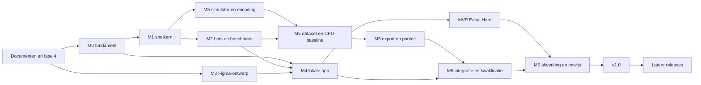

Status: Geaccepteerd

Versie: 1.3

Laatst gewijzigd: 2026-11-02

Gerelateerd: [Scope](01-product-vision-scope.md), [backlog](14-backlog.md), [kwaliteit](12-quality-testing.md), [neural network](07-neural-network.md), [leeswijzer](README.md), [ADR 0050](adr/0050-review-and-task-workflow.md)

# Roadmap en releasevoorwaarden

De roadmap beschrijft opleveringen en afhankelijkheden, geen taakstatus. GitHub Projects bepaalt welk werk Ready, In progress of afgerond is. Er zijn nog geen appreleases of gemeten modelresultaten; de documentatieopdracht en haar akkoordmomenten staan in de [leeswijzer](README.md#voortgang-en-hervatten).

## Voorwaarde voor de bouw

Batch F en fase 3 zijn goedgekeurd; de fase-4-inrichting moet vóór de bouw zijn afgerond volgens de masterprompt. Fase 4 verifieert alle zeven MCP-servers vóór repository-/bord-/handboekinrichting. De [projectconfiguratie](../.codex/config.toml) schakelt nu zeven servers in; de [verificatie](16-tooling-mcp.md#verificatieverslag-2026-11-02) is voor alle zeven verbindingen geslaagd. De privérepository, het Projects-bord met 59 gekoppelde issues en het Notion-handboek zijn ingericht; de [echte projectlinks](README.md#externe-projectlinks) zijn vastgelegd. De [workflowcontrole](16-tooling-mcp.md#externe-inrichting-2026-11-02) is afgerond met gebruikersscreenshots en teruggelezen API-statussen. De inrichting is gereed voor de fase-4-review; na akkoord kan de bouw beginnen. Deze inrichting is de huidige opdracht, geen bouwtaak die afhankelijk zou zijn van een nog niet bestaand bord.

De eerste bouwtaak is T01. T17 kan pas Ready worden na de expliciete stijlkeuze en de vereiste Figma-rechten. Uitvoeren gebeurt steeds op één taak; het ML-spoor maakt een andere volgorde mogelijk wanneer zijn afhankelijkheden gereed zijn.

## Afhankelijkheden tussen opleveringen

Dit diagram toont opleveringsgrenzen. De exacte voorgangers staan per taak in [14](14-backlog.md): bijvoorbeeld T23 kan al na de core en Easy starten, terwijl T33 de volledige M2/M3/M4-resultaten nodig heeft. M3 heeft functioneel geen voltooide ML-training nodig. T34/T35 kunnen direct na M1 starten; T36 gebruikt vervolgens de gedragsstrategieën en rolloutbasis uit M2; het trainingsantwoord blijft de echte bezetting, afzonderlijk van de publieke modelinput. Voor finale modelkwalificatie is zowel de benchmark als de werkende browserintegratie nodig.

## Mijlpalen

| Mijlpaal | Taken | Oplevering en afsluitcriterium |
|---|---|---|
| M0 — fundament | [T01](14-backlog.md#t01)–[T04](14-backlog.md#t04) | Gepinde workspace/tooling, importgrenzen, eerste CI- en browsertestomgeving, uitvoerbare setup en module-ingangen. De reeds ingerichte externe workflow wordt in de eerste echte PR's gecontroleerd. |
| M1 — game-core | [T05](14-backlog.md#t05)–[T10](14-backlog.md#t10) | Regels, bewezen plaatsbaarheid, RNG, commands/events, views, serialisatie en replay. Alle relevante RULE-/invariantfixtures en corecoveragepoorten slagen; TS-fixtures kunnen door Python worden hergebruikt. |
| M2 — tegenstanders | [T11](14-backlog.md#t11)–[T16](14-backlog.md#t16), [T23](14-backlog.md#t23) | Uniforme sampler, registry/contracttests, Easy/Normal/Hard, publieke sessiecoördinator en reproduceerbare benchmark. De head-to-head-arena gebruikt de gewone engine en sessie; Easy < Normal < Hard is volgens 06 op alle vier v1-configuraties aangetoond. |
| M3 — Figma | [T17](14-backlog.md#t17)–[T20](14-backlog.md#t20) | Expliciet gekozen stijl, tokens, alle 19 componenten, scherm-/foutstates, prototypes en mapping. Designreview volgens 09/10 is afgerond. |
| M4 — speelbare MVP | [T21](14-backlog.md#t21), [T22](14-backlog.md#t22), [T24](14-backlog.md#t24)–[T33](14-backlog.md#t33) | Volledige Easy–Hard-flow, hervatten, instellingen/uitleg, gereserveerde routes en statisch deploymentartefact. Alle toepasselijke Must/NFR-poorten inclusief EN/NL, keyboard, touch, browsermatrix en laadbudgetten slagen. |
| M5 — ML | [T34](14-backlog.md#t34)–[T43](14-backlog.md#t43) | Simulator/encodingpariteit, dataset, CPU-baseline, export, modeldiscovery, Worker-inferentie en expliciet foutherstel. Een kandidaat wordt pas na alle prestatie-/pariteits-/toestelcriteria standaard; de ontwikkelaar kan de pipeline zelfstandig herhalen. |
| M6 — afwerking | [T44](14-backlog.md#t44)–[T56](14-backlog.md#t56) | Geplande statistieken, effecten en AI-inzicht; module- en uitbreidingsproeven; volledige v1-a11y/i18n-, performance- en privacycontrole; releaseoverdracht. |

Mijlpaalnummers zijn geen kalenderafspraken. Een mijlpaal wordt pas als gerealiseerd vastgelegd wanneer de toepasselijke taken en afsluitcriteria aantoonbaar zijn afgerond. Budgetten, aantallen wedstrijden, fixturebetekenis en browserversiebeleid worden niet hier herhaald of versoepeld: [document 12](12-quality-testing.md) is de norm, met 06/07 voor de modelkwalificatie.

## MVP en v1.0

| Release | Vereist | Begrenzing |
|---|---|---|
| MVP na M4 | M0–M4 en de MVP-selectie van de acceptatie-/kwaliteitsmatrix; Easy–Hard-benchmarkbewijs; module-README's en proeven van de al beschikbare uitbreidingspunten | Impossible is herkenbaar maar zonder gekwalificeerd model uitgeschakeld. De werkende neural loader/inferentie en modelkwalificatie zijn nog geen MVP-claim. Should-effecten mogen ontbreken met eerlijke instellingen/uitleg. |
| v1.0 na M6 | M0–M6, inclusief CPU-pipeline, TS/Python/ONNX-pariteit, compatibel gekwalificeerd Impossible, alle toepasselijke Must/NFR's en de volledige menselijke uitbreidingsproeven | Geen backend of accounts. T44–T47 zijn gepland; verplaatsen van een Should vraagt expliciete scope-/dependencyreview. Could-taken zijn geen voorwaarde. |

Toegankelijkheid en beide talen worden tijdens iedere UI-taak gebouwd en bij T33 voor de MVP gecontroleerd. T53 herhaalt en verbreedt die controle voor de later toegevoegde model-/inzicht-/effectstates. Hetzelfde geldt voor veiligheid, documentatie en performance: geen uitgesteld basiswerk tot M6.

Een mislukte kwalificatie houdt de releasepoort dicht. Leg de oorzaak en het benodigde herstel als nieuw issue met nieuwe taak-ID vast; wijzig geen evaluatieseed, intervalmethode of budget achteraf om de kandidaat te laten slagen. Het leerdoel is ook gediend met een eerlijk negatief experiment, maar dat bewijst de productbelofte nog niet. MVP kan bruikbaar worden opgeleverd terwijl het ML-spoor nog geen v1-kandidaat heeft.

### Bewijs per release

T33 en T56 verbinden requirements/AT's aan werkelijk uitgevoerde checks. Bewaar commit/tag, builddigest, lockfile-/toolversies, browser-/OS-/toestelprofielen, CI-runlinks, handmatige review, ruwe benchmark-/traceartefacten en eventuele modelmanifestdigest. Een ontbrekende meting krijgt geen geslaagd vakje. Publicatie gebruikt het gecontroleerde artefact en de afgesproken hostingbestemming.

Na menselijke review en release worden hier versienummer, datum, scope en bewijs-/release-noteslinks toegevoegd. Notion bevat de leesbare release notes; Projects houdt resterende taken bij. Deze documentversie bevat nog geen ingevulde releasehistorie omdat geen apprelease bestaat.

## Externe voorwaarden en open punten

| Voorwaarde | Nodig vóór | Afhandeling |
|---|---|---|
| Zeven werkende MCP-servers, bestemmingen en rechten | Fase-4-inrichting, daarna elke relevante taak | [Q-02/03/04](README.md#centrale-open-punten) en het verificatierapport uit 16; geen fictieve auth- of bereikbaarheidstest |
| Expliciete stijlkeuze | T17/designgeneratie | ADR 0018 bijwerken; Harbor is een aanbeveling, geen reeds genomen besluit |
| Echte browser-/hulpmiddeltoegang, inclusief fysieke iPhone 16 Pro | T33 en T53 | Versies/condities vastleggen; Playwright-WebKit vervangt geen echte Safari- of VoiceOver-proef |
| Middenklassetoestel en meetvoorzieningen | T42 en T54 | [Q-06](README.md#centrale-open-punten): MID-ANDROID-v1 moet beschikbaar zijn of vóór meten expliciet door een gereviewd equivalent worden vervangen; iPhone 16 Pro is geen bewijs van gemiddelde hardware |
| Safari-traceomgeving | Framekwalificatie op IOS-16PRO-v1 | Voorziening en methode volgens 12 regelen; een ongeplugde handmatige iPhoneproef alleen levert geen ruwe framewerkmeting |

Deze voorwaarden blokkeren niet het afronden van de documentatie. Er zijn geen aankoop-, abonnements- of publicatiebesluiten verborgen in de planning.

## Latere releases

[T57](14-backlog.md#t57), [T58](14-backlog.md#t58) en [T59](14-backlog.md#t59) specificeren geschiedenis, offline/PWA en dark mode als Could. Hun M6-veld past binnen de afgesproken bordvelden; het label en de afhankelijkheid van T56 maken duidelijk dat zij na v1.0 worden beoordeeld. Ready zetten vereist een scopebesluit. Zij tellen niet mee voor het afronden van v1.0.

Daarna kan een afzonderlijke multiplayerrelease worden gepland: eerst private rooms met serverautoriteit/reconnect, vervolgens quick play. Het [toekomstontwerp](11-multiplayer-future.md) levert de grenzen, maar krijgt pas bij die releasekeuze server-/transporttaken, hostingbesluiten, tests en een actuele beveiligingsreview. `apps/server/README.md` is in v1 het enige serverbestand. Er is geen v1-taak die online matchmaking of accounts bouwt.

Gebruikersaccounts worden in v1 en de eerstvolgende releases niet gebouwd of gebruikt. Dit is een bewuste keuze voor nu; accounts kunnen in een latere release worden toegevoegd.
